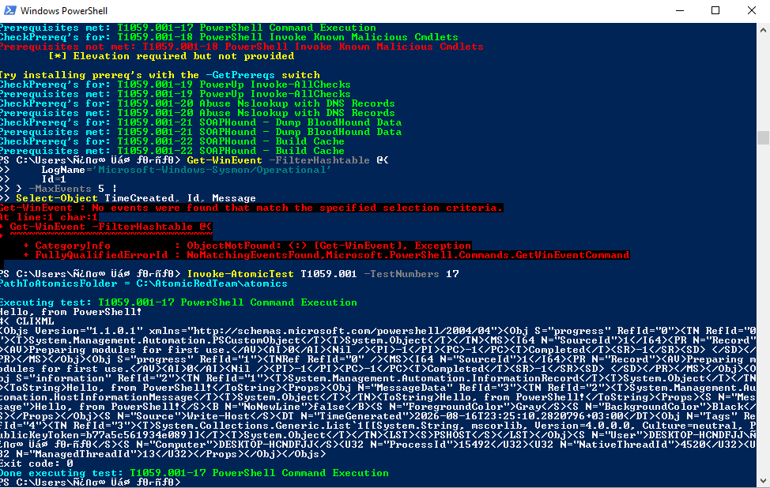
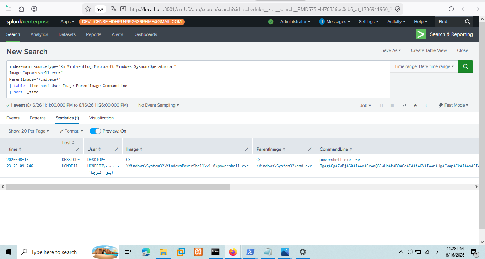
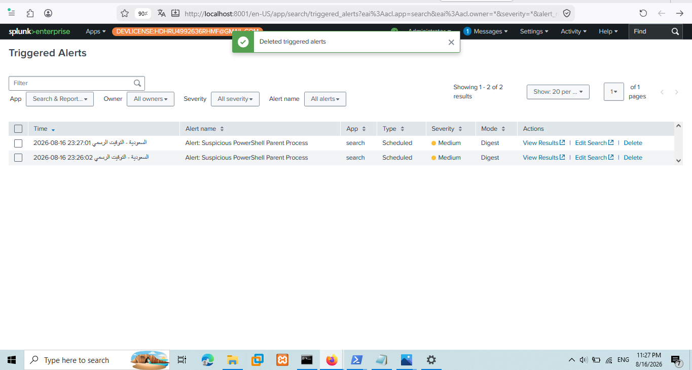
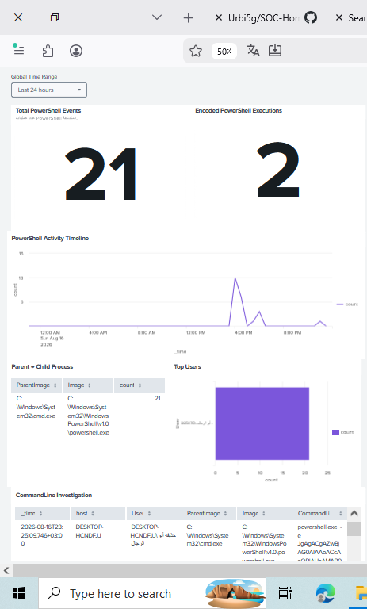

# PowerShell Attack Detection using Splunk

## Overview

This case study demonstrates how a PowerShell-based attack was simulated, detected, investigated, and documented using Splunk Enterprise and Sysmon.

The objective was to emulate realistic PowerShell execution behavior using Atomic Red Team (T1059.001) and build a complete SOC workflow including detection engineering, alerting, dashboard visualization, investigation, and MITRE ATT&CK mapping.

---

# Lab Environment

| Component | Description |
| --------- | ----------- |
| SIEM | Splunk Enterprise |
| Attack Framework | Atomic Red Team |
| Monitored Host | Windows 10 |
| Telemetry Source | Sysmon |
| Log Source | Microsoft-Windows-Sysmon/Operational |
| Splunk Index | `main` |
| Primary Event | Sysmon Event ID 1 - Process Creation |

---

# Attack Simulation

A PowerShell attack simulation was performed using Atomic Red Team mapped to MITRE ATT&CK T1059.001 – Command and Scripting Interpreter: PowerShell.

The simulation included multiple execution techniques such as standard PowerShell execution, encoded commands, download cradles, and obfuscation to generate realistic endpoint telemetry.

Attack commands are available here:

📄 **[attack/atomic_red_team_commands.txt](./attack/attack_commands.txt)**

---

# Attack Evidence

PowerShell Attack Execution via Atomic Red Team



---

# Detection Engineering

A custom SPL detection rule was developed to identify suspicious PowerShell execution based on parent-child process relationship (cmd.exe → powershell.exe) and encoded command-line parameters.

The detection focuses on identifying PowerShell spawned from a command shell, which is a common initial execution pattern.

Detection rule:

📄 **[detection/spl_query.txt](detection/spl_query.txt)**

```spl
index=main sourcetype="XmlWinEventLog:Microsoft-Windows-Sysmon/Operational"
Image="*powershell.exe*" ParentImage="*cmd.exe*"
| table _time host User Image ParentImage CommandLine ProcessId
| sort -_time
```

---

# Encoded PowerShell Detection

A second detection layer was developed to identify obfuscated execution using encoded parameters:

```spl
index=main sourcetype="XmlWinEventLog:Microsoft-Windows-Sysmon/Operational"
Image="*powershell.exe*"
(CommandLine="*-e *" OR CommandLine="*-enc *" OR CommandLine="*-EncodedCommand*")
| table _time host User Image ParentImage CommandLine ProcessId
| sort -_time
```

This detects: `-e`, `-enc`, `-EncodedCommand`

---

# Detection Search Result

The SPL search successfully identified the simulated PowerShell activity and extracted critical investigation fields including Host, User, ParentImage, CommandLine, and ProcessId.

Detection Search



---

# Alert Generation

A scheduled Splunk alert was configured to automatically trigger when suspicious PowerShell execution was detected, enabling real-time SOC notification.

Alert Triggered



---

# Detection Dashboard

A dedicated PowerShell Detection Dashboard was created to provide centralized visibility into suspicious PowerShell activity.

Dashboard capabilities include:

* PowerShell Execution Timeline
* Executing Hosts & Users
* Parent Process Analysis
* Command-Line Activity Monitoring
* Encoded PowerShell Activity
* Process ID Tracking
* Interactive Investigation Panel

Dashboard Preview



---

# Investigation Workflow

The investigation followed a standard SOC L1 workflow from detection to documentation.

Investigation Workflow

```text
Detection
   │
   ▼
Alert Review
   │
   ▼
Identify Host & User
   │
   ▼
Review Parent Process
   │
   ▼
Analyze Command Line
   │
   ▼
Identify Encoded PowerShell
   │
   ▼
Validate Sysmon Event
   │
   ▼
MITRE ATT&CK Mapping
   │
   ▼
Incident Documentation
```

Analyst Focus:

* Which host executed PowerShell?
* Which user context was used?
* What was the parent process?
* Was an encoded command used?
* Is the activity expected or malicious?

---

# Evidence Review

Sysmon Process Creation events (Event ID 1) were reviewed to validate the detection.

Evidence includes:

* Host: DESKTOP-HCNDFJJ
* Image: C:\Windows\System32\WindowsPowerShell\v1.0\powershell.exe
* Parent: C:\Windows\System32\cmd.exe
* User: DESKTOP-HCNDFJJ\حذيفه أبو الرجال
* Encoded Parameter: -e

The raw events confirm PowerShell was spawned by cmd.exe with an encoded command.

---

# Incident Report

The complete incident investigation report is available here:

📄 **[incident_report.md](./incident_report.md)**

The report includes Executive Summary, Timeline, Detection Logic, MITRE Mapping, Affected Assets, PICERL, and Lessons Learned.

---

# MITRE ATT&CK Mapping

| Tactic | Technique | ID | Relevance |
| ------ | --------- | -- | --------- |
| Execution | Command and Scripting Interpreter: PowerShell | T1059.001 | Primary Technique |
| Defense Evasion | Obfuscated Files or Information | T1027 | Supporting - Encoded Command |

---

# Project Workflow

```text
Atomic Red Team
      │
      ▼
PowerShell Execution
      │
      ▼
Sysmon Event (Process Creation)
      │
      ▼
Splunk Ingestion
      │
      ▼
SPL Detection Rule
      │
      ▼
Splunk Alert
      │
      ▼
Detection Dashboard
      │
      ▼
Analyst Investigation
      │
      ▼
MITRE ATT&CK Mapping
      │
      ▼
Incident Report
```


---

# Skills Demonstrated

* Splunk Enterprise
* SPL Query Development
* Detection Engineering
* Atomic Red Team
* Sysmon Analysis
* Windows Event Analysis
* PowerShell Threat Detection
* Process Tree Analysis
* Command-Line Analysis
* Encoded PowerShell Detection
* Alert Engineering
* Dashboard Development
* SOC Investigation Workflow
* MITRE ATT&CK Mapping
* Incident Response Documentation
