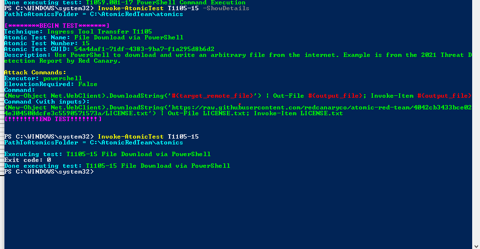
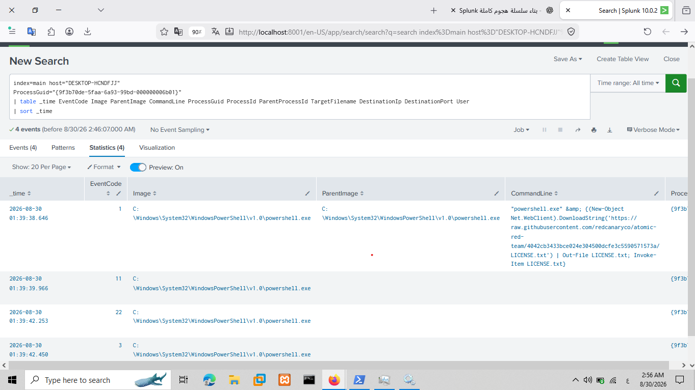
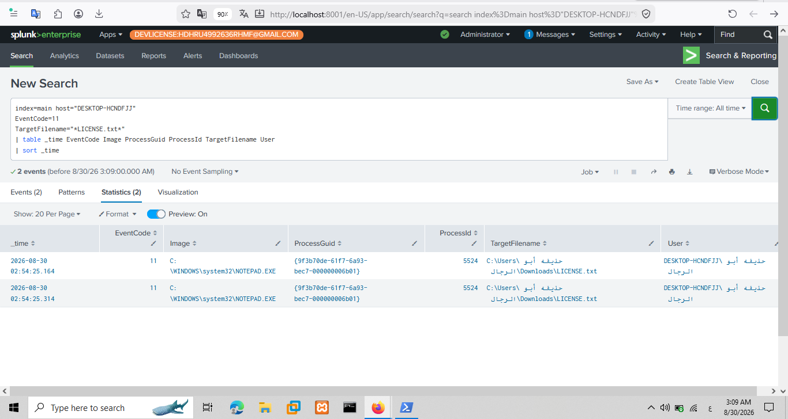
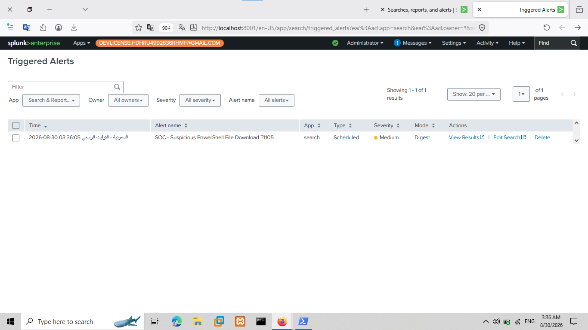
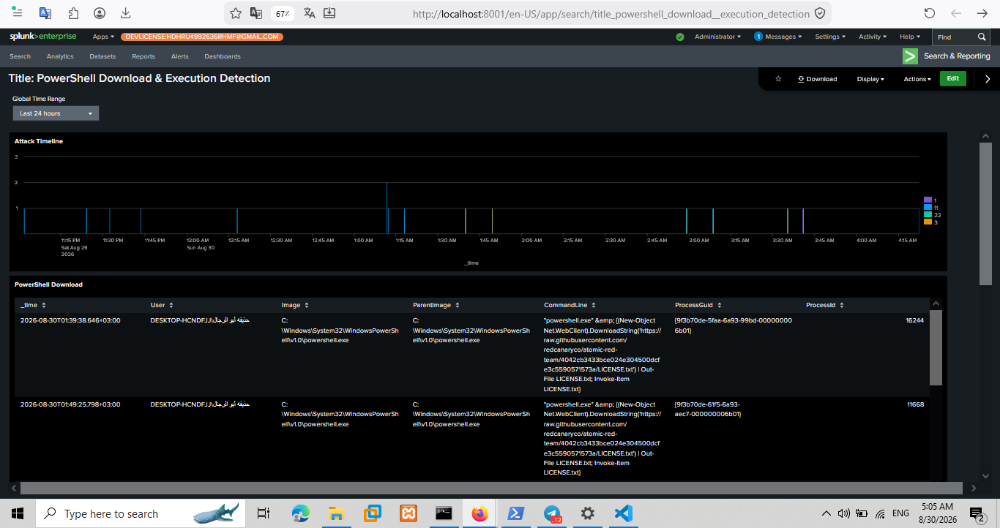
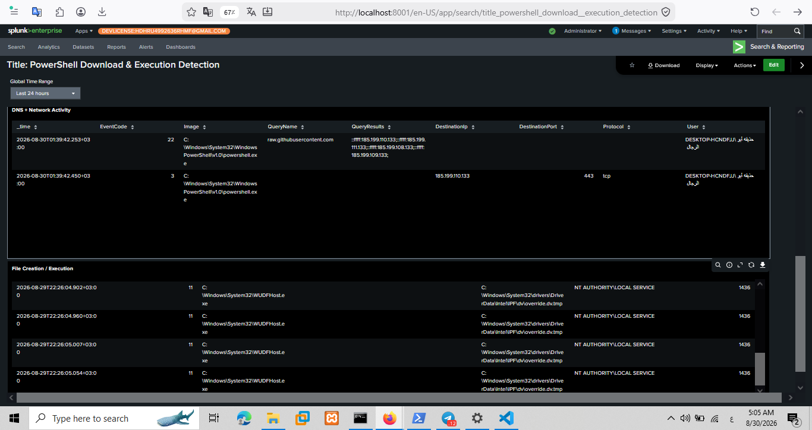

# Ingress Tool Transfer (T1105) Detection using Splunk

> **SOC Home Lab | Detection Engineering | Atomic Red Team | Splunk Enterprise | Sysmon**

---

## Case Overview

This case study documents the simulation, detection, alerting, investigation, and documentation of an **Ingress Tool Transfer** activity using **Atomic Red Team** and **Splunk Enterprise**.

The controlled activity used PowerShell to retrieve content from an external GitHub-hosted resource and save it locally. Sysmon telemetry was collected by Splunk and correlated across process creation, DNS resolution, network connection, and file creation events.

**Primary MITRE ATT&CK Technique:** T1105 — Ingress Tool Transfer

> **Environment:** Controlled SOC Home Lab  
> **Production Impact:** None  
> **Detection Status:** Successfully Detected  
> **Alert Status:** Triggered

---

# Case Summary

| Field | Value |
|------|-------|
| **Case ID** | SOC-2026-004 |
| **Attack Type** | Ingress Tool Transfer |
| **Primary Technique** | T1105 |
| **Attack Framework** | Atomic Red Team |
| **SIEM** | Splunk Enterprise |
| **Telemetry** | Sysmon |
| **Monitored Host** | DESKTOP-HCNDFJJ |
| **Splunk Index** | `main` |
| **Sourcetype** | `XmlWinEventLog:Microsoft-Windows-Sysmon/Operational` |
| **Primary Process** | `powershell.exe` |
| **Destination Port** | `443` |
| **Detection** | Splunk SPL |
| **Alert** | SOC - Suspicious PowerShell File Download T1105 |
| **Alert Severity** | Medium |
| **Status** | Closed |

---

# Lab Environment

| Component | Description |
|------------|-------------|
| SIEM | Splunk Enterprise |
| Attack Framework | Atomic Red Team |
| Endpoint | Windows 10 |
| Telemetry Source | Sysmon |
| Log Type | Windows Sysmon Operational |
| Index | `main` |
| Sourcetype | `XmlWinEventLog:Microsoft-Windows-Sysmon/Operational` |

The objective was to validate that the SOC environment could observe and detect an external file-transfer activity initiated through PowerShell.

---

# Attack Simulation

The attack was simulated with **Atomic Red Team** using **T1105 — Ingress Tool Transfer**.

The PowerShell activity used `Net.WebClient` and `DownloadString()` to retrieve content from:

`raw.githubusercontent.com`

The retrieved content was written to a local file named:

`LICENSE.txt`

The test generated useful endpoint telemetry including:

- PowerShell process creation
- External DNS resolution
- HTTPS network connection
- Local file creation
- File saved to disk
- File opened after creation

### Attack Documentation

📄 **[Atomic Test Documentation](./attack/atomic_test.md)**

---

# Attack Evidence

The attack was executed from the Windows endpoint using Atomic Red Team.



**Figure 1 — Atomic Red Team T1105 execution**

---

# Detection Engineering

A custom Splunk detection was developed to identify suspicious PowerShell download activity and correlate the resulting endpoint telemetry.

The investigation focused on:

- `_time`
- `EventCode`
- `Image`
- `ParentImage`
- `CommandLine`
- `ProcessGuid`
- `ProcessId`
- `TargetFilename`
- `DestinationIp`
- `DestinationPort`
- `QueryName`
- `User`

### Detection Documentation

📄 **[SPL Detection Query](./detection/spl_query.md)**

📄 **[Alert Configuration](./detection/alert_config.md)**

---

# Detection Result

The investigation correlated the following event sequence:

```text
PowerShell Process Creation
        ↓
DNS Resolution
        ↓
HTTPS Connection
        ↓
File Creation
        ↓
File Saved Locally
        ↓
Alert Triggered
```

The external resource resolved through:

`raw.githubusercontent.com`

A corresponding PowerShell network connection to TCP **443** was observed.



**Figure 2 — Correlated Sysmon detection events**

---

# File Creation Evidence

Sysmon **Event ID 11 — FileCreate** provided endpoint evidence that the retrieved content was written to disk.

The investigation identified the resulting file under the user's Downloads directory:

`C:\Users\<user>\Downloads\LICENSE.txt`



**Figure 3 — Downloaded file saved locally**

This event connects the external transfer activity to a concrete file-system change on the monitored endpoint.

---

# DNS & Network Evidence

Sysmon **Event ID 22 — DNS Query** recorded a DNS query for:

`raw.githubusercontent.com`

Sysmon **Event ID 3 — Network Connection** then recorded a PowerShell connection to the external destination over TCP port **443**.

The resulting correlation was:

```text
powershell.exe
      ↓
raw.githubusercontent.com
      ↓
DNS Query — Event ID 22
      ↓
HTTPS Connection — Event ID 3
      ↓
File Creation — Event ID 11
```

This correlation increased confidence that the PowerShell process was responsible for the observed external transfer.

---

# Alerting

A scheduled Splunk alert was configured for the suspicious PowerShell file-download behavior.

**Alert Name:**

`SOC - Suspicious PowerShell File Download T1105`

The alert successfully triggered during the controlled simulation.



**Figure 4 — Splunk detection alert**

---

# Detection Dashboard

A dedicated **PowerShell Download & Execution Detection** dashboard was created to provide analysts with centralized visibility.

The dashboard provides visibility into:

- Attack timeline
- PowerShell download activity
- Host
- User
- Process ID
- Process GUID
- Command line
- Parent process
- Network destination
- Destination port
- Related events



**Figure 5 — PowerShell Download & Execution Detection Dashboard**

An additional dashboard view was captured during the investigation:



**Figure 6 — Additional dashboard investigation view**

---

# Investigation Workflow

The investigation followed a practical SOC L1 workflow:

```text
Detection
   ↓
Alert Review
   ↓
Identify Host
   ↓
Identify User
   ↓
Review PowerShell Process
   ↓
Analyze Command Line
   ↓
Identify External Domain
   ↓
Validate DNS Event
   ↓
Validate HTTPS Connection
   ↓
Validate File Creation
   ↓
MITRE ATT&CK Mapping
   ↓
Incident Documentation
```

The analyst investigated:

- Which host performed the transfer?
- Which user executed PowerShell?
- Which process performed the download?
- What external domain was contacted?
- Was DNS resolution observed?
- Was an HTTPS connection established?
- Was a file created locally?
- What was the resulting file path?
- Did the Splunk alert trigger?
- Which MITRE ATT&CK technique applied?

---

# MITRE ATT&CK Mapping

| Tactic | Technique | ID | Relevance |
|--------|-----------|----|-----------|
| Command and Control | Ingress Tool Transfer | **T1105** | Primary technique |

### T1105 — Ingress Tool Transfer

The simulated activity involved transferring external content to the monitored Windows endpoint through PowerShell.

The technique was identified through the combination of:

- PowerShell execution
- External resource access
- DNS resolution
- HTTPS network connection
- Local file creation

> The test was performed in a controlled lab. These behaviors alone do not prove malicious activity in a production environment; analyst context and correlation are required.

---

# Evidence Review

| Evidence | File | Purpose |
|----------|------|---------|
| Attack Execution | `powershell_attack.png` | Demonstrates Atomic Red Team execution |
| Detection Events | `detection_events.png` | Shows correlated Sysmon telemetry |
| File Saved | `file_saved.png` | Demonstrates local file creation |
| Splunk Alert | `splunk_alert.png` | Demonstrates automated alert generation |
| Dashboard | `powershell_dashboard.png` | Shows the primary detection dashboard |
| Dashboard View 2 | `powershell_dashboard2.png` | Shows an additional dashboard view |

The evidence chain demonstrates:

```text
Attack Simulation
       ↓
Sysmon Telemetry
       ↓
Splunk Ingestion
       ↓
Detection Logic
       ↓
Alert
       ↓
Dashboard
       ↓
SOC Investigation
       ↓
MITRE ATT&CK Mapping
       ↓
Incident Documentation
```

---

# Incident Documentation

The complete investigation is documented in:

📄 **[Incident Report](./incident_report.md)**

The report contains the detailed incident timeline, investigation findings, evidence, MITRE ATT&CK mapping, analysis, and recommendations.

---

# Repository Structure

```text
04-Ingress-Tool-Transfer-T1105/
│
├── README.md
├── incident_report.md
│
├── attack/
│   └── atomic_test.md
│
├── detection/
│   ├── alert_config.md
│   └── spl_query.md
│
└── evidence/
    ├── pcaps/
    ├── raw_logs/
    └── screenshots/
        ├── detection_events.png
        ├── file_saved.png
        ├── powershell_attack.png
        ├── powershell_dashboard.png
        ├── powershell_dashboard2.png
        └── splunk_alert.png
```

---

# SOC Skills Demonstrated

- Splunk Enterprise
- SPL Query Development
- Detection Engineering
- Atomic Red Team
- MITRE ATT&CK
- Sysmon Analysis
- PowerShell Monitoring
- Process Analysis
- Command-Line Analysis
- DNS Event Analysis
- Network Connection Analysis
- File Creation Monitoring
- Alert Engineering
- Dashboard Development
- SOC L1 Investigation
- Threat Hunting
- Incident Documentation

---

# Complete SOC Workflow

```text
Atomic Red Team
      ↓
T1105 Ingress Tool Transfer
      ↓
PowerShell Download
      ↓
Sysmon Telemetry
      ↓
Splunk Ingestion
      ↓
SPL Detection
      ↓
Splunk Alert
      ↓
Detection Dashboard
      ↓
Analyst Investigation
      ↓
MITRE ATT&CK Mapping
      ↓
Incident Report
```

---

# Conclusion

The T1105 simulation successfully demonstrated how a controlled PowerShell-based file transfer can be observed across multiple layers of endpoint telemetry.

The investigation connected:

**Process Creation → DNS Query → HTTPS Connection → File Creation → Alert → Dashboard → Investigation**

This case demonstrates a practical SOC L1 workflow for moving from raw endpoint telemetry to a validated security detection and documented incident.

**Case Status:** Successfully Detected and Investigated  
**Primary MITRE Technique:** T1105 — Ingress Tool Transfer  
**Environment:** Controlled SOC Home Lab  
**Production Impact:** None
