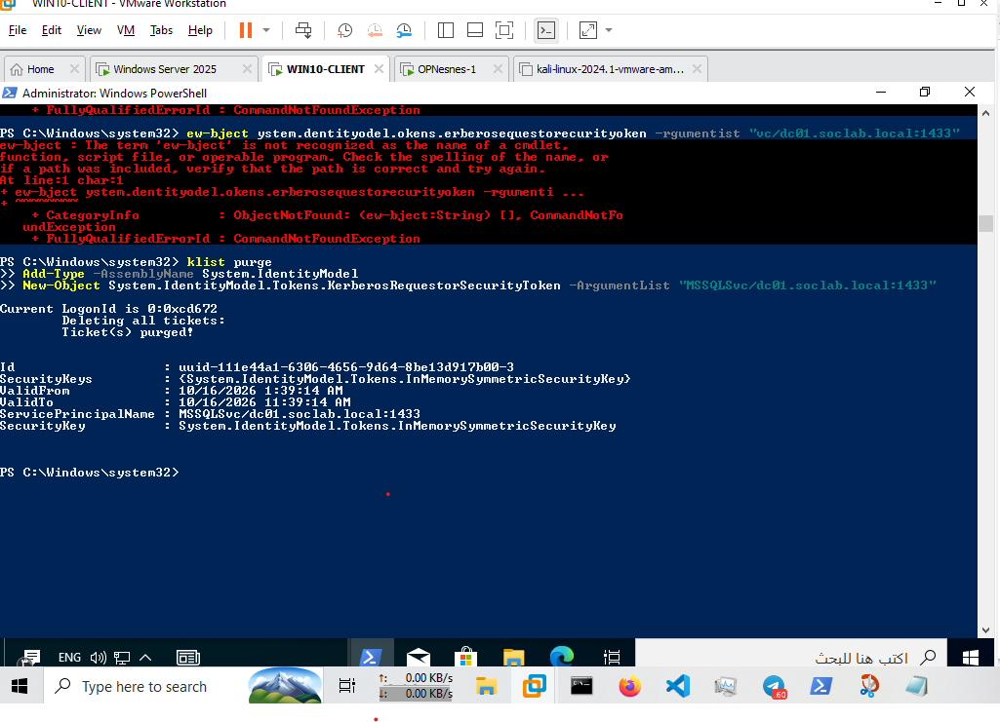
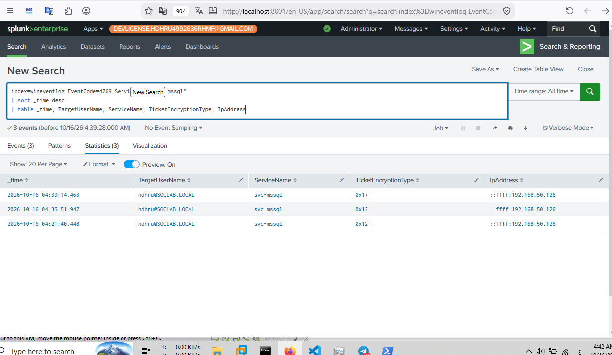

# Kerberoasting Detection (T1558.003) using Splunk

> **SOC Home Lab | Detection Engineering | Active Directory | Splunk Enterprise | Splunk Security Essentials (SSE) | Atomic Red Team**

---

## Case Overview

This case study documents the investigation of Kerberos service-ticket activity potentially associated with **Kerberoasting**, using a controlled Active Directory lab, Windows Security Event Logs, Splunk Enterprise, and Splunk Security Essentials (SSE).

The investigation involved manually requesting a Kerberos service ticket for a service principal name (SPN), reviewing Windows Security Event ID `4769` in Splunk, and examining ticket encryption metadata for RC4-HMAC (`0x17`).

The investigation identified six matching events in the observed Splunk search result set. These events were associated with the `svc-mssql` service account and contained the RC4-HMAC encryption type. However, the event timestamps have not been correlated with the exact time of the manual service-ticket request. RC4 usage alone does not establish malicious Kerberoasting.

An Atomic Red Team test for T1558.003 was also attempted. The test did not complete because the Windows endpoint could not resolve `raw.githubusercontent.com`.

Splunk Security Essentials (SSE) was used in the detection and alert-configuration workflow. The alert was saved, but its actual triggering behavior has not yet been verified.

**Primary MITRE ATT&CK Technique:** T1558.003 — Kerberoasting

> **Environment:** Controlled SOC Home Lab  
> **Production Impact:** None reported  
> **Investigation Status:** In Progress  
> **Detection Status:** Relevant Kerberos events identified; malicious activity not confirmed  
> **Alert Status:** Saved; triggering not verified  
> **Atomic Red Team Status:** Test attempted but incomplete

---

# Case Summary

| Field | Value |
|---|---|
| **Case ID** | SOC-2026-005 |
| **Attack Type** | Potential Kerberoasting Activity |
| **Primary Technique** | T1558.003 |
| **Attack Framework** | Atomic Red Team — test attempted, incomplete |
| **SIEM** | Splunk Enterprise 10.0.2 |
| **Detection Content Workflow** | Splunk Security Essentials (SSE) |
| **Telemetry Source** | Windows Security Event Log |
| **Domain** | `soclab.local` |
| **Domain Controller** | `Ad-DC.soclab.local` |
| **Domain Controller IP** | `192.168.50.10` |
| **Monitored Endpoint** | `DESKTOP-9SMH3UQ` |
| **Requesting Account Observed in Events** | `hdhru@SOCLAB.LOCAL` |
| **Service Account** | `svc-mssql` |
| **Target SPN** | `MSSQLSvc/dc01.soclab.local:1433` |
| **Splunk Index** | `wineventlog` |
| **Relevant Event ID** | `4769` |
| **Observed Ticket Encryption Type** | `0x17` — RC4-HMAC |
| **Detection Method** | Splunk SPL |
| **Alert Workflow** | Splunk Security Essentials (SSE) and Splunk alert configuration |
| **Alert Severity** | Not asserted here; verify the saved alert configuration |
| **Alert Execution** | Not verified |
| **Case Status** | Open — Investigation In Progress |
| **Report Author** | Huthifa |

---

# Lab Environment

| Component | Description |
|---|---|
| SIEM | Splunk Enterprise 10.0.2 |
| Detection Content | Splunk Security Essentials (SSE) |
| Directory Service | Microsoft Active Directory |
| Domain | `soclab.local` |
| Domain Controller | `Ad-DC.soclab.local` |
| Domain Controller Address | `192.168.50.10` |
| Endpoint Operating System | Windows 10 |
| Endpoint Hostname | `DESKTOP-9SMH3UQ` |
| Requesting Account | `hdhru` |
| Service Account | `svc-mssql` |
| Log Source | Windows Security Event Log |
| Splunk Index | `wineventlog` |
| Relevant Event | Kerberos Service Ticket Operations — Event ID `4769` |
| Attack Simulation Framework | Atomic Red Team |
| Investigation Interface | Splunk Search & Reporting |

The objective was to assess the lab's visibility into Kerberos service-ticket requests, examine encryption-related indicators, and develop a preliminary detection workflow for activity potentially associated with Kerberoasting.

---

# Attack Simulation

The investigation included a manual Kerberos service-ticket request from the domain-joined Windows 10 endpoint.

The target service principal name was:

`MSSQLSvc/dc01.soclab.local:1433`

The associated service account identified during the investigation was:

`svc-mssql`

## Manual PowerShell Activity

The following commands were executed in the controlled lab:

```powershell
klist purge

Add-Type -AssemblyName System.IdentityModel

New-Object System.IdentityModel.Tokens.KerberosRequestorSecurityToken -ArgumentList "MSSQLSvc/dc01.soclab.local:1433"
```

### Command Explanation

| Command | Purpose |
|---|---|
| `klist purge` | Clears cached Kerberos tickets for the current logon session. |
| `Add-Type -AssemblyName System.IdentityModel` | Loads the .NET assembly used by the subsequent operation. |
| `KerberosRequestorSecurityToken` | Requests a Kerberos service ticket for the specified SPN. |

The manual request demonstrates a Kerberos-related operation against the specified service SPN. It does not, by itself, demonstrate ticket extraction, offline password cracking, or credential compromise.

## Atomic Red Team Test

The following test was attempted:

```powershell
Invoke-AtomicTest T1558.003 -TestNumbers 1
```

The prerequisite check indicated that the prerequisites were met. However, the actual test execution encountered a DNS resolution error while attempting to retrieve a PowerShell resource hosted on `raw.githubusercontent.com`.

The retrieval failed, and `Invoke-Kerberoast` was not available in the session.

Although the Atomic execution output displayed `Exit code 0` and a completion message, the errors indicate that the intended test did not complete successfully.

**Atomic Test Result:** Incomplete — DNS resolution failure.

The manual service-ticket request and the incomplete Atomic test are documented as separate activities. The investigation does not assume that either activity generated every event returned by the Splunk searches.

### Attack Documentation

📄 **[Atomic Test Documentation](./attack/atomic_test.md)**

---

# Attack Evidence

The manual service-ticket request was performed from the Windows 10 endpoint in the controlled lab.



**Figure 1 — PowerShell activity used to request a Kerberos service ticket.**

This evidence is intended to document the commands executed during the manual test. It should not be interpreted as proof that a complete Kerberoasting attack or password-cracking operation occurred.

---

# Detection Engineering

The detection workflow used Splunk Enterprise to search Windows Security Event ID `4769` and inspect service-ticket attributes.

Splunk Security Essentials (SSE) was used as part of the detection-content and alert-configuration workflow.

The investigation focused on the following fields where available:

- `_time`
- `EventCode`
- `host`
- `Computer`
- `TargetUserName`
- `ServiceName`
- `TicketEncryptionType`
- `TicketOptions`
- `IpAddress`

## Initial Investigation Query

The following SPL query was used to investigate service-ticket activity associated with `svc-mssql`:

```spl
index=wineventlog EventCode=4769 ServiceName="svc-mssql"
| sort _time desc
| table _time, TargetUserName, ServiceName, TicketEncryptionType, IpAddress
```

This query was used to review the event timeline, requesting account, service account, encryption type, and requester IP address where populated.

## RC4-HMAC Investigation Query

The following query was used to identify events matching the selected encryption type and ticket-options conditions:

```spl
index=wineventlog sourcetype=XmlWinEventLog EventCode=4769
TicketEncryptionType="0x17"
(TicketOptions="0x40810000" OR TicketOptions="0x40800000" OR TicketOptions="0x40810010")
| table _time host Computer TargetUserName ServiceName TicketEncryptionType TicketOptions
| sort - _time
```

The observed search returned six matching events.

### Detection Documentation

📄 **[SPL Detection Query](./detection/spl_query.md)**

📄 **[Alert Configuration](./detection/alert_config.md)**

---

# Detection Result

The Splunk search returned six events matching the selected conditions in the observed result set.

The returned events contained the following common attributes:

| Field | Observed Value |
|---|---|
| `host` | `Ad-DC` |
| `Computer` | `Ad-DC.soclab.local` |
| `TargetUserName` | `hdhru@SOCLAB.LOCAL` |
| `ServiceName` | `svc-mssql` |
| `TicketEncryptionType` | `0x17` |
| `TicketOptions` | `0x40810000` |

The results demonstrate that matching Kerberos service-ticket events were available in the Splunk index.

The six events must not be interpreted as six confirmed attack attempts. Their timestamps have not been correlated with the exact time of the manual request, and the use of RC4-HMAC is not conclusive evidence of malicious activity.



**Figure 2 — Splunk search results showing Kerberos Event ID 4769 and RC4-HMAC-related fields.**

## Detection Assessment

The investigation established the following:

- Relevant Kerberos service-ticket events were present in Splunk.
- The observed events included `TicketEncryptionType=0x17`.
- The events were associated with `svc-mssql`.
- The manual request's exact relationship to these events remains unverified.
- The Atomic Red Team test did not complete.
- The saved alert's triggering behavior remains unverified.

**Assessment:** Potentially relevant Kerberos activity identified; malicious Kerberoasting not confirmed.

---

# Kerberos Event Analysis

## Event ID 4769 — Kerberos Service Ticket Operations

Windows Security Event ID `4769` records Kerberos service-ticket request activity on a domain controller.

It is useful for investigating service-ticket behavior because the event may contain information about the requesting account, requested service, ticket encryption type, and other request attributes.

In this investigation, Event ID `4769` was used to examine activity associated with the `svc-mssql` service account.

## Ticket Encryption Type `0x17`

The value `0x17` corresponds to RC4-HMAC encryption.

RC4 usage can be relevant to Kerberoasting investigations because service-ticket encryption characteristics can influence the feasibility of offline password cracking. However, legitimate environments may also contain RC4-encrypted tickets.

The encryption type should therefore be evaluated alongside other context, including:

- The requesting account and source host.
- The requested SPN and associated service account.
- The number of distinct SPNs requested.
- Request frequency and deviations from the normal baseline.
- Service-account privilege level and password practices.
- Supporting authentication and endpoint telemetry.

## Correlation Limitations

The current evidence does not establish that the manual PowerShell request directly caused the six events returned by the query.

A timestamp comparison between the command execution and the Windows Security events is still required. Additional event details and a controlled retest would improve confidence in the correlation.

---

# Alerting — Splunk Security Essentials (SSE)

Splunk Security Essentials (SSE) was used in the detection-content and alert-configuration workflow for this scenario.

The relevant detection logic was saved for further validation. However, saving a detection or alert configuration does not establish that an alert has fired.

| Item | Status |
|---|---|
| Detection Search | Investigated in Splunk |
| Detection Content Workflow | SSE used |
| Alert Configuration | Saved |
| Alert Trigger | Not verified |
| Successful Automated Detection | Not yet confirmed |

## Alert Validation Requirements

The following items should be checked before reporting the alert as successfully triggered:

1. Confirm the saved alert name and its associated SPL search.
2. Verify the schedule and time range.
3. Confirm the alert's trigger condition and result threshold.
4. Ensure the search returns relevant events within the configured time window.
5. Review the alert's execution history or triggered-alert records.
6. Capture evidence of a real alert execution before marking the alert as triggered.

The exact alert name, severity, schedule, and trigger condition should be documented from the actual saved configuration rather than inferred.

📄 **[Alert Configuration Details](./detection/alert_config.md)**

---

# Investigation Workflow

The investigation followed a practical SOC analyst workflow:

```text
Prepare Controlled Lab
        |
        v
Identify Target Service SPN
        |
        v
Perform Manual Service-Ticket Request
        |
        v
Review Windows Security Event 4769
        |
        v
Inspect Service Account and Encryption Type
        |
        v
Develop and Test SPL Search
        |
        v
Review Detection Content in SSE
        |
        v
Save Alert Configuration
        |
        v
Validate Alert Execution
        |
        v
Correlate Event Timeline
        |
        v
Review Supporting Evidence
        |
        v
Map to MITRE ATT&CK
        |
        v
Document Findings and Recommendations
```

The investigation considered the following questions:

- Which account was recorded as requesting the service ticket?
- Which service account and SPN were involved?
- Was Event ID `4769` available in Splunk?
- Which ticket encryption type was recorded?
- Did the event timestamps match the manual test?
- Did the Atomic Red Team test complete?
- Was the saved alert actually triggered?
- Is there evidence of ticket extraction or offline password cracking?
- What additional validation is needed before closing the case?

---

# MITRE ATT&CK Mapping

| Tactic | Technique | ID | Relevance |
|---|---|---|---|
| Credential Access | Kerberoasting | **T1558.003** | Primary investigation technique |

## T1558.003 — Kerberoasting

Kerberoasting involves requesting service tickets for accounts associated with SPNs and attempting to recover service-account credentials through offline cracking.

The lab investigation examined Kerberos service-ticket requests and RC4-HMAC encryption metadata relevant to this technique.

The observed behavior is relevant to a Kerberoasting investigation, but Event ID `4769` and RC4 encryption alone do not prove that the complete attack technique was executed.

> This technique mapping describes the investigation's focus. It is not a declaration that malicious activity or credential compromise was confirmed.

---

# Evidence Review

| Evidence | File | Purpose |
|---|---|---|
| Manual PowerShell Activity | `powershell_attack.png` | Documents the manual service-ticket request. |
| Kerberos Detection Events | `detection_events.png` | Shows relevant Event ID 4769 search results. |
| SPL Detection Query | `spl_query.md` | Documents the search logic used for investigation. |
| Alert Configuration | `alert_config.md` | Documents the saved alert configuration and validation status. |
| Atomic Test Documentation | `atomic_test.md` | Records the attempted test and the DNS failure. |
| Incident Report | `incident_report.md` | Records the findings, limitations, and recommendations. |

The screenshot paths in this table refer to the planned repository evidence locations. The corresponding files must be added before the evidence package is considered complete.

## Evidence Chain

```text
Manual Service-Ticket Request
             |
             v
Windows Security Event Review
             |
             v
Splunk Search Results
             |
             v
RC4-HMAC Attribute Analysis
             |
             v
Detection Content and Alert Configuration
             |
             v
Timeline and Alert Validation
             |
             v
SOC Investigation
             |
             v
Incident Documentation
```

The chain represents the investigation workflow. It does not imply that every step has been successfully validated.

---

# Incident Documentation

The detailed investigation findings are documented in:

📄 **[Incident Report](./incident_report.md)**

The incident report includes:

- Case summary and lab environment.
- Manual service-ticket request details.
- Atomic Red Team execution limitations.
- Splunk search queries and observed results.
- Kerberos event and encryption-type analysis.
- Alert validation status.
- MITRE ATT&CK mapping.
- Investigation limitations and recommendations.

---

# Repository Structure

```text
05-Kerberoasting-Detection/
│
├── README.md
├── incident_report.md
│
├── attack/
│   └── atomic_test.md
│
├── detection/
│   ├── alert_config.md
│   └── spl_query.md
│
└── evidence/
    ├── pcaps/
    ├── raw_logs/
    └── screenshots/
        ├── detection_events.png
        └── powershell_attack.png
```

The structure separates the attack simulation, detection logic, alert configuration, incident analysis, and supporting evidence to make the scenario easier to review and reproduce.

---

# SOC Skills Demonstrated

- Splunk Enterprise Search & Reporting
- Splunk SPL Query Development
- Splunk Security Essentials (SSE) Detection Workflow
- Security Alert Configuration and Validation
- Windows Security Event Analysis
- Active Directory Fundamentals
- Kerberos Authentication Analysis
- Service Principal Name (SPN) Investigation
- RC4-HMAC Encryption Analysis
- MITRE ATT&CK Mapping
- Atomic Red Team Test Execution and Troubleshooting
- Incident Investigation
- Evidence Documentation
- Detection Limitations and False-Positive Awareness
- SOC L1 Investigation Workflow

---

# Complete SOC Workflow

```text
Active Directory Lab
         |
         v
Manual Kerberos Service-Ticket Request
         |
         v
Windows Security Event 4769
         |
         v
Splunk Event Ingestion
         |
         v
SPL Investigation
         |
         v
RC4-HMAC and SPN Analysis
         |
         v
SSE Detection and Alert Workflow
         |
         v
Alert Validation
         |
         v
Timeline Correlation
         |
         v
SOC Investigation
         |
         v
MITRE ATT&CK Mapping
         |
         v
Incident Report
```

The workflow documents the intended investigation process. Alert validation and complete attack simulation remain outstanding.

---

# Conclusion

This case study demonstrates a practical approach to investigating Kerberos service-ticket activity using Active Directory telemetry, Splunk Enterprise, SPL, and Splunk Security Essentials (SSE).

The investigation identified six matching events in the observed Splunk search results, including the `svc-mssql` service account and the RC4-HMAC encryption type `0x17`. A manual service-ticket request was also performed against the `MSSQLSvc/dc01.soclab.local:1433` SPN.

However, the available evidence does not yet establish a direct timestamp correlation between the manual request and the returned events. The Atomic Red Team test remained incomplete because of a DNS resolution failure, and the saved alert's triggering behavior has not been verified.

The next steps are to correlate the event timeline, resolve the Atomic test's connectivity issue, validate the alert's execution, and complete the evidence package.

**Case Status:** Open — Investigation In Progress  
**Primary MITRE Technique:** T1558.003 — Kerberoasting  
**SIEM:** Splunk Enterprise 10.0.2  
**Detection Content Workflow:** Splunk Security Essentials (SSE)  
**Production Impact:** None reported  
**Next Steps:** Timeline correlation, Atomic test troubleshooting, alert validation, and evidence review

---

**Report Author:** Huthifa  
**Project:** SOC Home Lab | Splunk Detection Engineering & Incident Response