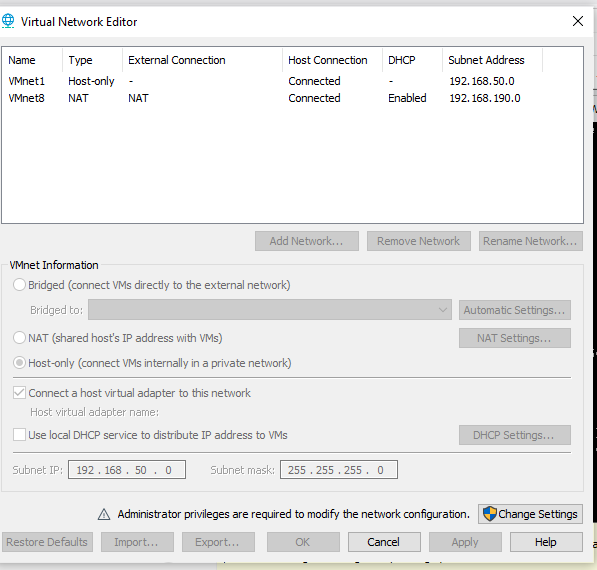
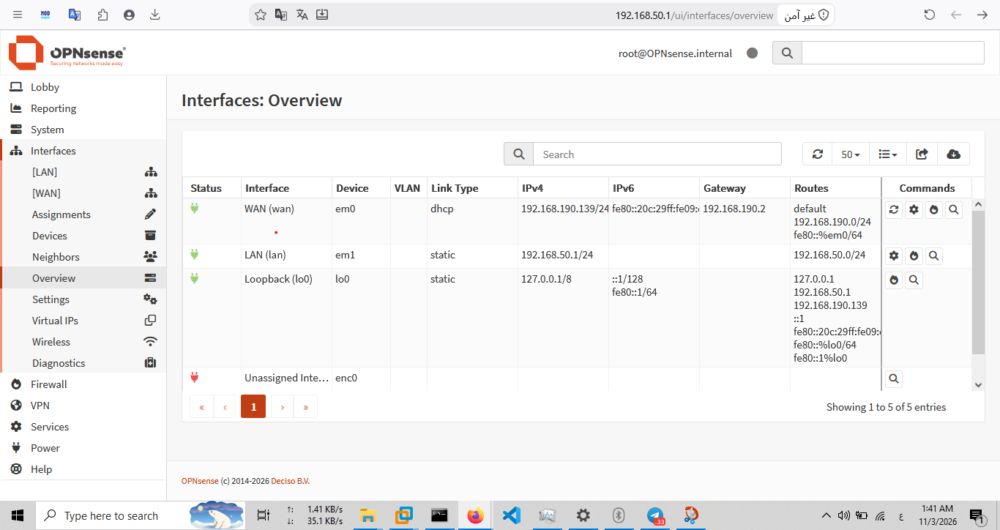
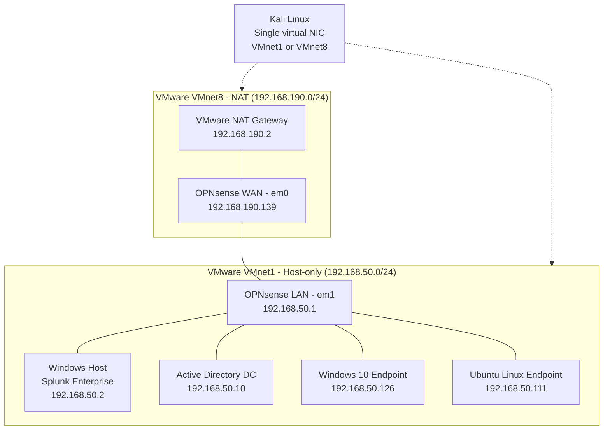
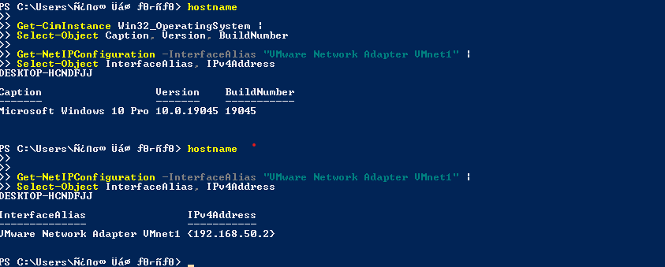
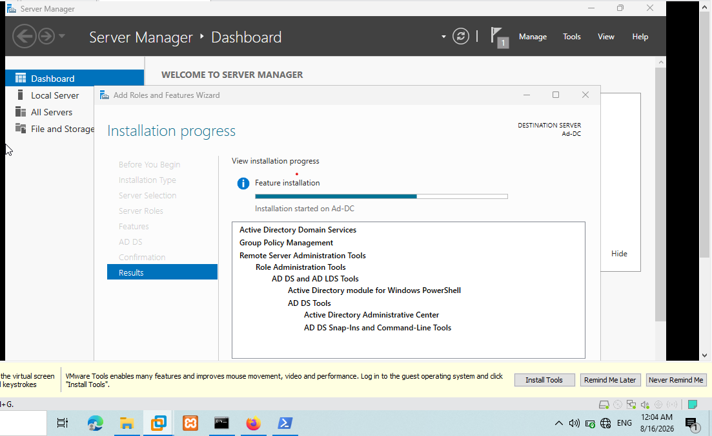
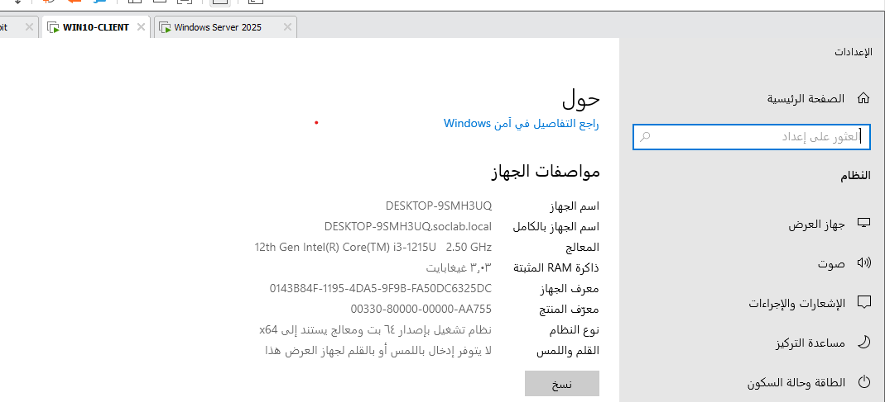
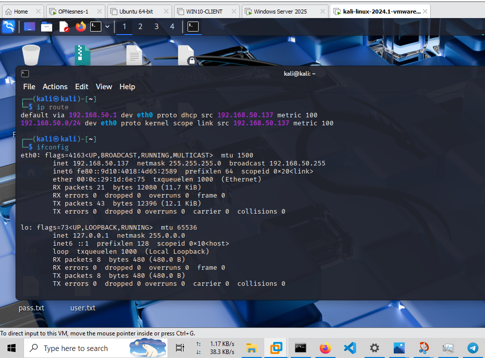
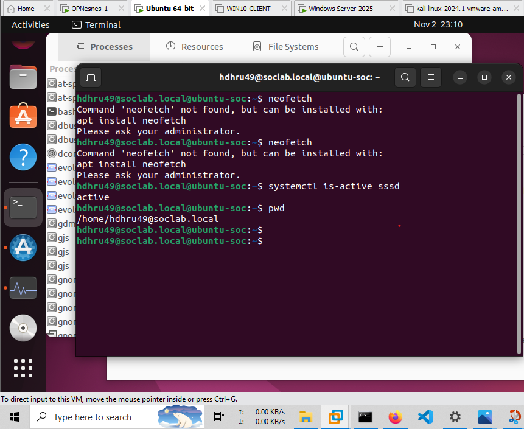
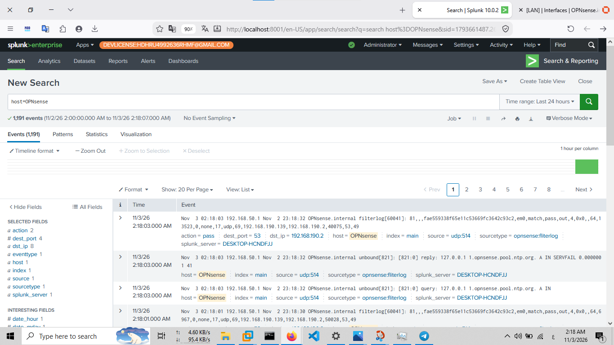
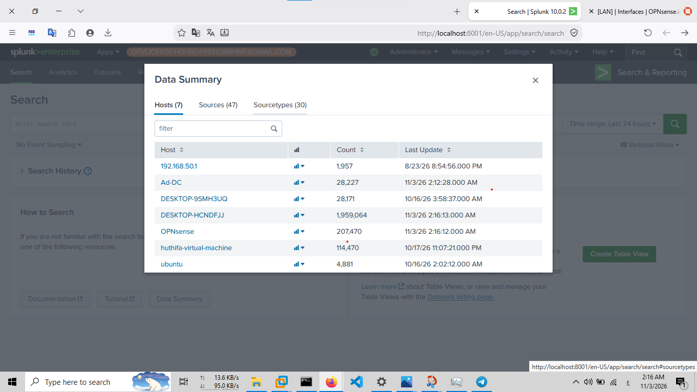

# SOC Home Lab — Infrastructure Overview

## 1. Overview

This document describes the infrastructure and network architecture of the SOC Home Lab, a virtualized environment designed for security monitoring, centralized log collection, threat detection, threat hunting, and incident response.

The lab combines network security infrastructure, a Windows Active Directory environment, Windows and Linux endpoints, an attacker simulation system, and a centralized Security Information and Event Management (SIEM) platform.

The main components include:

- OPNsense firewall for network segmentation, routing, and security monitoring.
- Splunk Enterprise running directly on the Windows host system for centralized log analysis.
- Windows Server acting as the Active Directory Domain Controller.
- Windows 10 domain endpoint generating Windows security telemetry.
- Ubuntu Linux endpoint providing Linux system and authentication logs.
- Kali Linux used for authorized security testing and attack simulation.
- Suricata integrated with OPNsense for network intrusion detection and monitoring.

The environment supports practical Blue Team activities, including log analysis, detection engineering, threat hunting, security event correlation, and incident investigation.

## 2. Lab Components

The following table summarizes the main systems and their roles within the lab.

| Component | Role | Address / Identifier |
|---|---|---|
| Windows Host | Host operating system and Splunk Enterprise platform | `192.168.50.2` (VMnet1) |
| OPNsense Firewall | Firewall, routing, and network security services | LAN: `192.168.50.1` |
| OPNsense WAN | External-side interface connected to VMware NAT | `192.168.190.139` |
| Splunk Enterprise | Centralized SIEM and log analysis platform | Hosted on Windows Host |
| Active Directory Domain Controller | Directory services, domain authentication, and DNS | `192.168.50.10` |
| Windows 10 Endpoint | Domain workstation and Windows telemetry source | `192.168.50.126` |
| Ubuntu Linux Endpoint | Linux system and authentication-log source | `192.168.50.111` |
| Kali Linux | Attacker simulation and authorized security testing | `192.168.50.137` when connected to VMnet1 |
| Suricata | Network intrusion detection and traffic monitoring | Integrated with OPNsense |

**Infrastructure notes:**

- Splunk Enterprise is installed directly on the Windows Host, not on a separate Ubuntu virtual machine.
- The Splunk Web interface is accessed locally through `http://127.0.0.1:8001`.
- Kali Linux has a single virtual network adapter. Its network attachment can be changed between VMnet1 and VMnet8 depending on the testing scenario.
- The Kali IP address shown above represents its observed address when connected to VMnet1. Its address may change when connected to VMnet8.
- The Ubuntu hostname is `huthifa-virtual-machine`.
- IP addresses represent observed lab configuration values and should be revalidated after network changes.

## 3. Virtual Network Architecture

The lab uses VMware Workstation virtual networking to separate the internal lab environment from the NAT-connected external-side network.

### 3.1 VMware Virtual Networks

| Network | Type | Subnet | Purpose |
|---|---|---|---|
| VMnet1 | Host-only | `192.168.50.0/24` | Internal SOC lab network |
| VMnet8 | NAT | `192.168.190.0/24` | External-side connectivity through VMware NAT |

**VMnet1 — Internal Network**

VMnet1 provides the dedicated internal network used by the main lab systems.

The Windows Host connects to this network through its VMware Network Adapter VMnet1 interface.

The internal network includes:

- OPNsense LAN interface: `192.168.50.1`
- Windows Host / Splunk: `192.168.50.2`
- Active Directory Domain Controller: `192.168.50.10`
- Windows 10 Endpoint: `192.168.50.126`
- Ubuntu Linux Endpoint: `192.168.50.111`
- Kali Linux: `192.168.50.137` when attached to VMnet1

VMnet1 uses the `192.168.50.0/24` subnet with VMware DHCP disabled.

**VMnet8 — NAT Network**

VMnet8 provides NAT connectivity through VMware.

It is connected to the WAN interface of OPNsense.

The observed configuration includes:

- Network: `192.168.190.0/24`
- OPNsense WAN address: `192.168.190.139`
- VMware NAT gateway: `192.168.190.2`

VMnet8 uses VMware DHCP, while OPNsense receives its WAN address through DHCP.

### 3.2 VMware Network Configuration Evidence

The following screenshot documents the VMware virtual network configuration, including the VMnet1 and VMnet8 network types and their subnet information.



### 3.3 OPNsense Network Interfaces

OPNsense connects the two virtual networks through separate interfaces.

| Interface | Device Name | Configuration | Connected Network |
|---|---|---|---|
| WAN | `em0` | DHCP — `192.168.190.139` | VMnet8 |
| LAN | `em1` | Static — `192.168.50.1/24` | VMnet1 |

The WAN interface connects to the VMware NAT network, while the LAN interface serves as the default gateway for the internal lab network.

**OPNsense Interface Evidence**

The following screenshot shows the configured WAN and LAN interfaces and their observed IP addresses.



### 3.4 Network Topology

The following diagram represents the logical network layout of the lab.



**Topology notes:**

- OPNsense is positioned between VMnet8 and VMnet1.
- The internal systems use VMnet1 for lab communication.
- The Windows Host provides the Splunk Enterprise platform.
- Kali Linux can be attached to either network for different authorized testing scenarios.
- When Kali is connected to VMnet8, it simulates an external-side source relative to the OPNsense WAN interface. This does not represent a real public Internet attacker.

## 4. Host System and SIEM Platform

### 4.1 Windows Host

The Windows Host is the physical host operating system running VMware Workstation and Splunk Enterprise.

Its VMware VMnet1 network adapter provides connectivity to the internal lab network.

The observed VMnet1 address is:

`192.168.50.2`

**Windows Host Evidence**

The following screenshot documents the Windows host system information.



### 4.2 Splunk Enterprise

Splunk Enterprise is installed directly on the Windows Host and serves as the central SIEM platform in the lab.

It provides the interface used to search, analyze, correlate, and investigate collected security events.

The local Splunk Web interface is accessed through:

`http://127.0.0.1:8001`

Splunk is used to centralize searchable security telemetry from configured lab data sources.

## 5. Active Directory Environment

The lab includes a Windows Active Directory environment used to simulate enterprise domain operations and generate authentication-related security events.

The domain is:

`SOCLAB.LOCAL`

The Domain Controller provides directory services and domain authentication. DNS is also part of the domain infrastructure.

The Windows 10 endpoint is joined to the domain and is used to generate endpoint activity and Windows security telemetry.

**Active Directory Server Evidence**

The following screenshot documents the Active Directory server and its system or domain information.



**Windows Domain Endpoint Evidence**

The following screenshot documents the Windows 10 endpoint identity and domain membership.



This environment supports investigation of:

- Domain authentication events.
- Account activity and privilege usage.
- Kerberos authentication and service-ticket events.
- Windows logon activity.
- Suspicious PowerShell execution.
- Active Directory security events.
- Credential-related attack simulations.

## 6. Linux and Security Testing Systems

### 6.1 Kali Linux

Kali Linux is used as the attacker simulation system for authorized security testing within the lab.

It has a single virtual network adapter that can be attached to VMnet1 or VMnet8, depending on the testing scenario.

**Kali Linux Evidence**

The following screenshot documents the Kali system identity and observed network configuration.



### 6.2 Ubuntu Linux Endpoint

Ubuntu Linux acts as a Linux endpoint and a source of system and authentication telemetry.

Its observed hostname is:

`huthifa-virtual-machine`

Its previously observed internal network address is:

`192.168.50.111`

**Ubuntu Linux Evidence**

The following screenshot documents the Ubuntu system identity and network configuration.



## 7. Network Security Monitoring

### 7.1 Suricata

Suricata is integrated with OPNsense to provide network intrusion detection and monitoring capabilities.

It supports the analysis of network traffic and the identification of suspicious activity through security alerts.

**Suricata Monitoring Evidence**

The following screenshot documents the Suricata monitoring interface and the service information visible in the lab.



The presence of Suricata does not by itself establish that every alert is forwarded to Splunk. Its log forwarding and ingestion status are documented and validated separately.

## 8. Log Collection and SIEM Ingestion

Splunk Enterprise acts as the central log analysis platform.

The lab uses configured log forwarding and event collection mechanisms to make endpoint and security telemetry searchable in Splunk.

### 8.1 Windows Universal Forwarder

The documented Windows Universal Forwarder destination is:

`192.168.50.2:9997`

This is the configured forwarding destination for the Windows endpoint.

Successful forwarding and event ingestion must be validated independently for each configured endpoint and log source.

### 8.2 Log Sources

The lab is designed to collect and investigate telemetry from multiple sources, including:

| Source | Telemetry |
|---|---|
| Windows Security Event Log | Authentication, account, and security events |
| Sysmon | Process creation, file activity, and network connection telemetry |
| PowerShell | Script execution and PowerShell operational events |
| Active Directory | Domain authentication and Kerberos-related events |
| Ubuntu Linux | Authentication and system logs |
| OPNsense | Firewall and network security events |
| Suricata | Network intrusion detection alerts |

The actual availability of each source in Splunk depends on its collection and forwarding configuration.

### 8.3 Event Ingestion Validation

Splunk searches are used to verify which hosts, indexes, and sourcetypes have searchable events.

The following search provides an overview of indexed event distribution:

```spl
index=*
| stats count AS events BY index host sourcetype
| sort host sourcetype
```

The results can be reviewed to identify:

- Which hosts are represented in Splunk.
- Which indexes contain their events.
- Which sourcetypes are available.
- The number of indexed events for each host and sourcetype.

**Splunk Log Ingestion Evidence**

The following screenshot shows the observed Splunk search results grouped by host, index, and sourcetype.



A successful search confirms that matching events are indexed and searchable. It does not, by itself, prove that every event from every endpoint is being forwarded continuously.

## 9. Security Monitoring and Detection Objectives

The infrastructure supports the following Blue Team activities:

- Windows Security Event Log analysis.
- Sysmon process and network telemetry analysis.
- PowerShell activity monitoring.
- Linux authentication and system-log analysis.
- Active Directory authentication monitoring.
- Kerberos service-ticket investigation.
- Suspicious process execution detection.
- Network reconnaissance and authentication-attack detection.
- Suricata alert monitoring.
- Threat hunting and event correlation.
- Detection rule development and validation.
- Incident documentation and evidence collection.

The lab follows a practical detection workflow:

`Attack Simulation → Telemetry Collection → SPL Detection → Alert Validation → Dashboard → Incident Report`

## 10. Security and Testing Scope

All attack simulations and security testing activities are conducted within the authorized home lab environment.

Kali Linux is used as a controlled testing system to simulate selected attack techniques against lab systems.

When attached to VMnet8, Kali represents an external-side testing source relative to the OPNsense WAN interface. It does not represent an actual public Internet attacker.

No testing is intended against systems or networks without explicit authorization.

Passwords, authentication tokens, private keys, and other sensitive information must not be published in the repository.

## 11. Validation and Maintenance

Infrastructure details may change as virtual machines, network adapters, and services are modified.

The following information should be revalidated whenever the lab configuration changes:

- VMware virtual network configuration.
- OPNsense WAN and LAN addresses.
- Hostname and IP address of each endpoint.
- Active Directory domain membership.
- Splunk service and Web interface availability.
- Universal Forwarder destination and connectivity.
- Configured log sources and forwarding status.
- Splunk indexes, hosts, and sourcetypes.
- Suricata service status and monitoring configuration.
- Evidence of successful event ingestion.

The infrastructure documentation should be updated whenever a virtual machine is added, removed, renamed, or reconfigured.

---

**Document Purpose:** SOC Home Lab Infrastructure Reference

**Environment:** VMware Workstation Virtualized Lab

**Primary SIEM:** Splunk Enterprise

**Firewall:** OPNsense

**Network Segmentation:** VMnet1 Host-only and VMnet8 NAT

**Domain:** `SOCLAB.LOCAL`