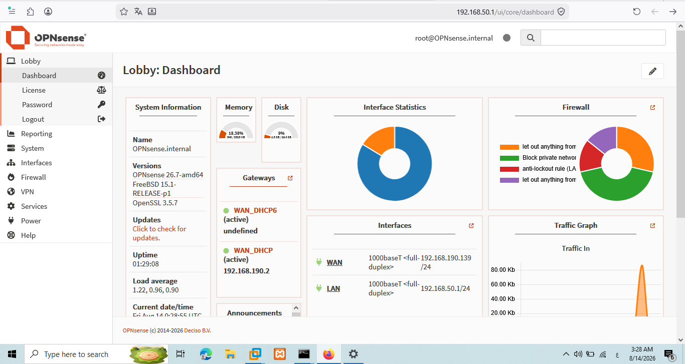
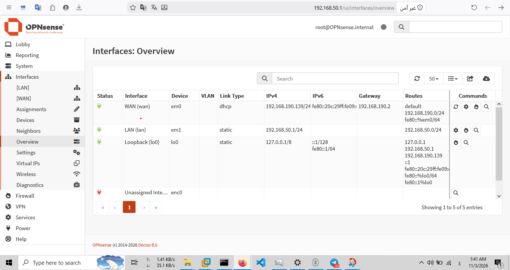
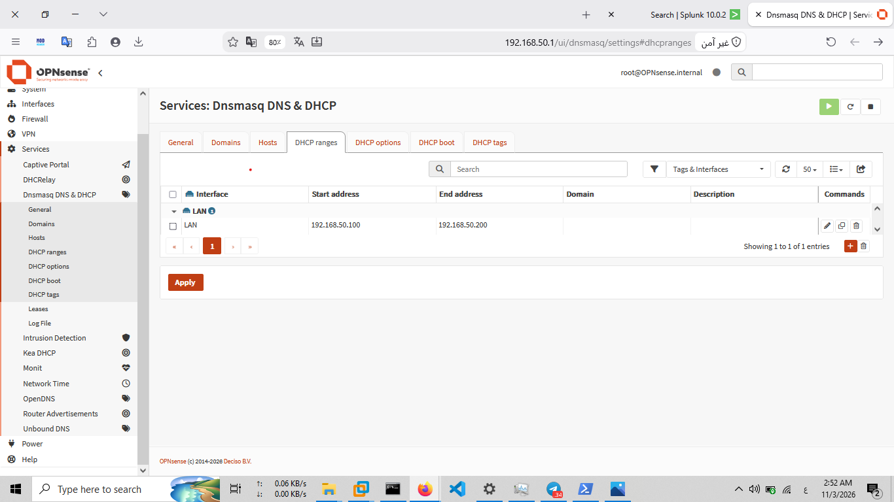

# OPNsense Firewall Configuration

## 1. Overview

This document describes the core configuration of the OPNsense firewall deployed in the SOC Home Lab.

OPNsense serves as the central network security gateway, providing network segmentation, IP addressing services, and firewall capabilities for the lab environment.

The firewall separates the internal lab network from the VMware NAT-connected network.

## 2. System Information

OPNsense is deployed as a virtual machine running on VMware Workstation.

The following screenshot documents the firewall system information and installed software version.

## 3. Network Interface Configuration

The OPNsense virtual machine uses two network interfaces connected to separate VMware virtual networks.

| Interface | Device | IPv4 Configuration | IP Address | VMware Network |
|---|---|---|---|---|
| WAN | em0 | DHCP | 192.168.190.139 | VMnet8 (NAT) |
| LAN | em1 | Static | 192.168.50.1/24 | VMnet1 (Host-only) |

### 3.1 WAN Interface

- Connected to VMware VMnet8.
- Configured as a DHCP client.
- Obtains its IPv4 configuration from the VMware NAT network.
- Uses the VMware NAT gateway at `192.168.190.2`.

### 3.2 LAN Interface

- Connected to VMware VMnet1.
- Configured with the static IPv4 address `192.168.50.1/24`.
- Acts as the default gateway for internal lab systems.
- Provides network connectivity to internal lab endpoints.

The following screenshot documents the OPNsense interface configuration.

## 4. DHCP Configuration

OPNsense provides DHCP services for the internal LAN network, allowing connected lab systems to obtain their IP configuration automatically.

### 4.1 WAN DHCP

The WAN interface operates as a DHCP client and receives its IP configuration from the VMware NAT network.

### 4.2 LAN DHCP Server

The DHCP server is enabled on the LAN interface.

It dynamically assigns IP addresses to devices connected to the internal lab network, reducing the need to configure each endpoint manually.

The LAN interface uses the `192.168.50.0/24` subnet.

The following screenshot documents the LAN DHCP configuration.

## 5. Network Design Summary

The lab network is divided into two virtual network segments:

| Network | Purpose | Subnet | DHCP Role |
|---|---|---|---|
| VMnet8 | WAN connectivity through VMware NAT | 192.168.190.0/24 | VMware DHCP provides the WAN address |
| VMnet1 | Internal SOC lab network | 192.168.50.0/24 | OPNsense DHCP server assigns endpoint addresses |

OPNsense connects these two network segments through its WAN and LAN interfaces.

This architecture provides a dedicated internal network for lab systems while maintaining a separate WAN-facing network.

## 6. Configuration Scope

This document covers the following OPNsense configuration areas:

- System information and software version.
- WAN and LAN interface configuration.
- WAN DHCP client configuration.
- LAN DHCP server configuration.
- VMware virtual network integration.

Firewall access policies and remote logging configuration are documented separately:

- `firewall-rules.md`
- `syslog-forwarding.md`