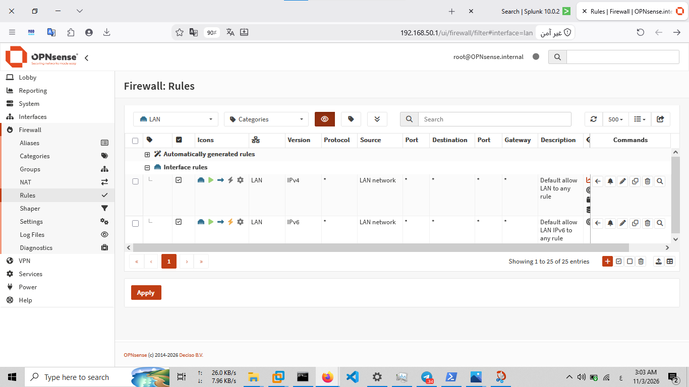

# OPNsense Firewall Rules

## 1. Overview

This document describes the firewall rule configuration and traffic control policies implemented on the OPNsense firewall in the SOC Home Lab.

Firewall rules determine which network traffic is permitted or blocked when passing through the firewall. They provide the enforcement mechanism for controlling communication between network segments and protecting internal lab systems.

This documentation focuses on the LAN interface rules captured from the current lab configuration.

## 2. Firewall Rule Processing

OPNsense uses interface-based firewall rules to control network traffic.

When reviewing firewall policies, the following properties are important:

| Property | Description |
|---|---|
| Action | Defines whether matching traffic is passed, blocked, or rejected. |
| Interface | Identifies the interface on which the rule is applied. |
| Protocol | Specifies the network protocol matched by the rule, such as TCP, UDP, or ICMP. |
| Source | Defines the originating host, network, or alias. |
| Destination | Defines the target host, network, or alias. |
| Destination Port | Specifies the destination service port when applicable. |
| Logging | Determines whether matching traffic is recorded in firewall logs. |
| Description | Provides context about the purpose of the rule. |

Rule order is important because it affects how traffic matches the configured policy. Specific rules should be reviewed in relation to broader rules and their position in the ruleset.

## 3. LAN Firewall Rules

The LAN interface is connected to the internal SOC lab network:

- Interface: LAN
- Device: `em1`
- Network: `192.168.50.0/24`
- Firewall address: `192.168.50.1`

The LAN firewall rules control traffic entering OPNsense from the internal lab network.

The following screenshot provides visual evidence of the LAN firewall rules configured in the lab.

### 3.1 Rule Review

The configured LAN rules should be reviewed using the following criteria:

- Identify the action associated with each rule.
- Verify the source and destination networks.
- Review the protocols and destination ports.
- Determine whether traffic logging is enabled.
- Examine rule descriptions and their intended purpose.
- Review rule order to understand policy precedence.

The screenshot represents the configuration at the time it was captured. Individual rule behavior should be interpreted from its actual fields rather than inferred from its description alone.

## 4. WAN Firewall Rules

The WAN interface connects OPNsense to the VMware NAT network.

The WAN interface uses the following network configuration:

- Interface: WAN
- Device: `em0`
- Network: `192.168.190.0/24`
- Firewall address: `192.168.190.139`

A dedicated WAN firewall rules screenshot is not currently included in the lab evidence. Therefore, this document does not make specific claims about individual WAN rules.

WAN rule analysis can be added when corresponding configuration evidence is available.

## 5. Security Considerations

Firewall rules should be reviewed periodically to ensure that they enforce the intended network security policy.

Important review considerations include:

- Apply least-privilege principles when defining permitted traffic.
- Avoid unnecessarily broad source and destination definitions.
- Restrict access to sensitive services and management interfaces.
- Enable logging for rules where security monitoring is required.
- Review rule ordering to avoid unintended policy matches.
- Remove obsolete or unnecessary rules.
- Investigate unexpected blocked or permitted traffic through firewall logs.

## 6. Monitoring and Investigation

Firewall logs can support SOC monitoring and incident investigation by providing visibility into network traffic decisions.

Relevant investigation activities include:

- Identifying repeated blocked connection attempts.
- Investigating unexpected traffic between internal systems.
- Reviewing connections to unusual destination addresses or ports.
- Correlating firewall events with endpoint and network telemetry.
- Identifying potential reconnaissance or unauthorized access attempts.

Firewall events should be correlated with other available telemetry before classifying activity as malicious.

## 7. Documentation Scope and Evidence

This document currently covers the LAN firewall rules using the available configuration screenshot.

The following evidence is included:

| Evidence | File |
|---|---|
| LAN firewall rules | `14-opnsense-lan-firewall-rules.png` |

WAN rule details are intentionally excluded until supporting evidence is available.

## 8. Related Documentation

- [OPNsense Configuration](configuration.md)
- [OPNsense Syslog Forwarding](syslog-forwarding.md)