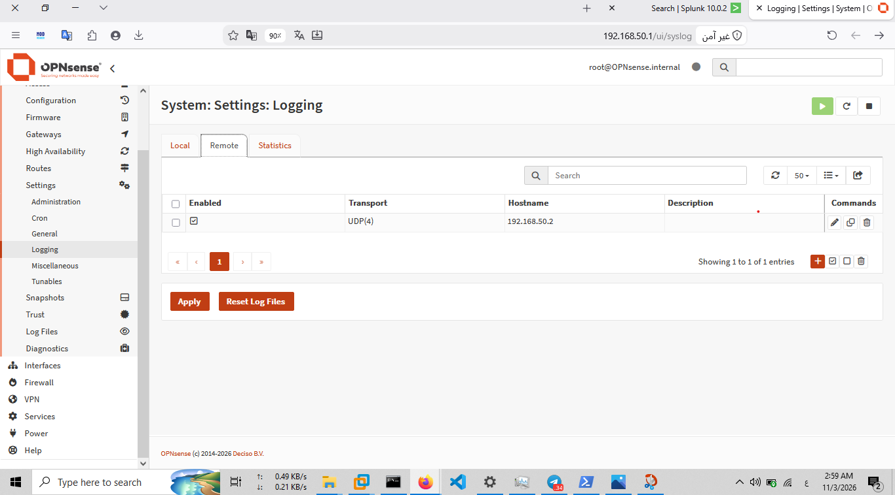
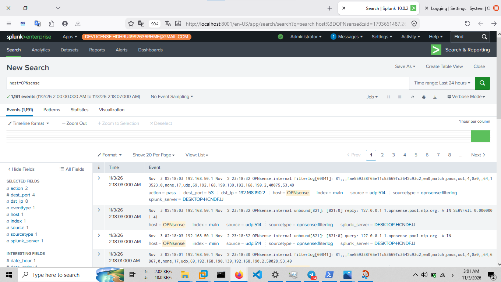

# OPNsense Syslog Forwarding

## 1. Overview

This document describes the remote syslog forwarding configuration between the OPNsense firewall and the Splunk SIEM platform in the SOC Home Lab.

Centralized log collection enables security monitoring, event investigation, and correlation of firewall telemetry with logs generated by other lab systems.

OPNsense acts as a log source, while Splunk serves as the centralized platform for searching and analyzing collected events.

## 2. Log Forwarding Architecture

The log forwarding workflow consists of the following stages:

1. OPNsense generates firewall and system events.
2. The configured remote logging service forwards selected events to the designated syslog destination.
3. Splunk receives and indexes the forwarded events.
4. Security analysts search and investigate the collected telemetry using Splunk Search Processing Language (SPL).

### 2.1 Lab Components

| Component | Role |
|---|---|
| OPNsense Firewall | Generates and forwards firewall and system logs |
| Splunk Enterprise | Centralized log collection, indexing, searching, and analysis |
| Syslog | Log forwarding mechanism |

The Splunk server is hosted on the Windows host machine, with the internal lab address `192.168.50.2`.

## 3. Remote Syslog Configuration

OPNsense supports remote logging to forward selected system and firewall events to an external syslog destination.

The remote logging configuration should identify the following parameters:

| Parameter | Description |
|---|---|
| Remote Server | Destination address of the centralized log collector |
| Transport Protocol | Syslog transport protocol |
| Destination Port | Remote syslog listening port |
| Selected Log Facilities | Event categories configured for forwarding |

The following screenshot documents the remote syslog configuration in OPNsense.



### 3.1 Transport Configuration

The lab uses the configured remote syslog transport settings shown in the OPNsense configuration.

The transport protocol and destination port should be interpreted from the captured configuration rather than assumed from default syslog settings.

## 4. Splunk Log Reception and Verification

Successful configuration of remote forwarding does not, by itself, prove that events have reached Splunk.

Log reception must be verified by searching for events originating from OPNsense in Splunk Search & Reporting.

The following screenshot provides evidence of OPNsense log events visible in Splunk.



### 4.1 Verification Objectives

The received events should be reviewed for the following fields:

- `host`: Identifies the reported event source.
- `source`: Indicates the input or source associated with the event.
- `sourcetype`: Identifies the event data format.
- `_time`: Represents the event timestamp assigned by Splunk.
- `_raw`: Contains the original event data.

These fields help validate event visibility and support subsequent analysis.

### 4.2 Example SPL Searches

The following searches can be used to inspect the ingested events.

**Identify available OPNsense-related events:**

```spl
index=*
| search host=*opnsense* OR source=*opnsense* OR sourcetype=*syslog*
| stats count AS event_count BY index host source sourcetype
| sort - event_count
```

**Review recent events:**

```spl
index=*
| search host=*opnsense* OR source=*opnsense* OR sourcetype=*syslog*
| sort - _time
| table _time host source sourcetype _raw
```

These are example discovery searches. Actual index, host, source, and sourcetype values should be adjusted to match the events received in the lab.

## 5. SOC Monitoring and Investigation Use Cases

Centralized firewall logging supports several SOC monitoring and investigation activities.

Examples include:

- Reviewing blocked connection attempts.
- Investigating unexpected network traffic.
- Identifying repeated connection attempts from a single source.
- Examining communication with unusual destination addresses or ports.
- Correlating firewall events with endpoint security logs.
- Investigating possible reconnaissance and unauthorized access activity.

Firewall events should be correlated with other available telemetry before determining whether an activity is malicious.

## 6. Logging and Monitoring Considerations

The reliability and usefulness of centralized logging depend on several operational factors:

- Ensure that the remote syslog destination is reachable.
- Verify that the configured protocol and destination port match the receiving input.
- Confirm that the required event categories are selected for forwarding.
- Monitor event timestamps and investigate unexpected time differences.
- Review indexing and field extraction to ensure that events are searchable.
- Periodically validate that log forwarding continues to operate.

## 7. Evidence Summary

| Evidence | File | Purpose |
|---|---|---|
| Remote syslog configuration | `16-opnsense-remote-syslog-configuration.png` | Documents the forwarding configuration |
| OPNsense events in Splunk | `17-opnsense-logs-in-splunk.png` | Documents the visibility of firewall events in Splunk |

## 8. Related Documentation

- [OPNsense Configuration](configuration.md)
- [OPNsense Firewall Rules](firewall-rules.md)