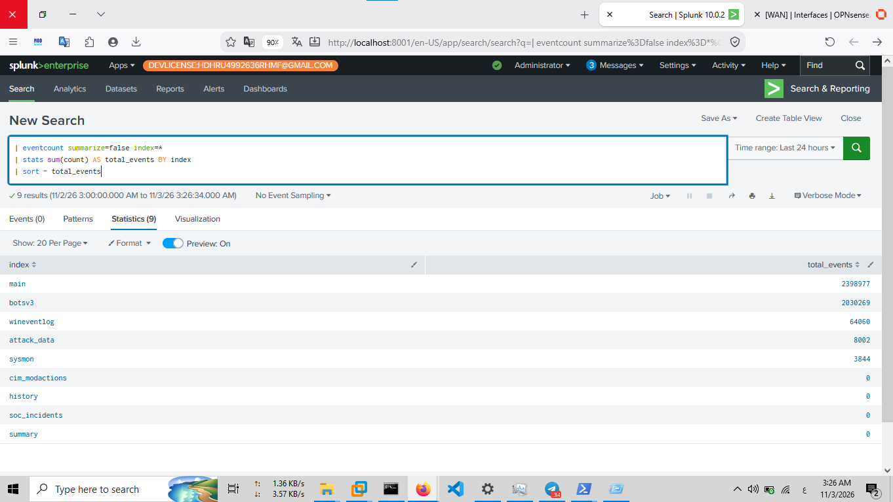
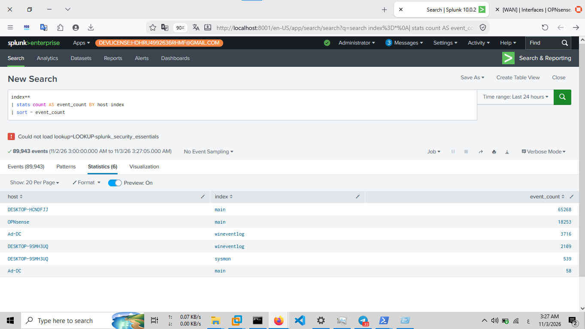
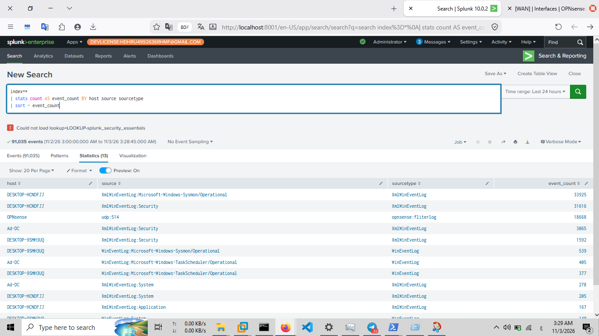

# Splunk Data Ingestion & Event Analysis

## 1. Overview

This document describes the data ingestion and event verification process within the SOC Home Lab using Splunk Enterprise.

Data ingestion is a fundamental part of SIEM operations. It enables security telemetry generated by different systems and security components to become searchable and available for monitoring, threat hunting, and incident investigation.

Splunk Enterprise provides centralized search capabilities for examining ingested events, identifying their sources, and understanding the distribution of collected data across the lab environment.

## 2. Data Ingestion Architecture

The SOC Home Lab uses Splunk Enterprise as its central platform for indexing and analyzing security events.

The data ingestion workflow can be summarized as follows:

1. Lab systems and security components generate event data.
2. Data is collected through the applicable collection mechanisms.
3. Events are forwarded or ingested into Splunk Enterprise.
4. Splunk indexes the incoming data.
5. Analysts search and investigate the indexed events using Search Processing Language (SPL).

### Central SIEM Configuration

| Component | Configuration |
|---|---|
| SIEM Platform | Splunk Enterprise |
| Splunk Version | 10.0.2 |
| Splunk Host IP | `192.168.50.2` |
| Splunk Web | `http://127.0.0.1:8001` |
| Internal Network | `192.168.50.0/24` |

## 3. Splunk Indexes

Indexes are logical storage locations used by Splunk to organize and retrieve ingested machine data.

The lab uses indexes to separate and organize event data for investigation and analysis.

Two previously identified indexes include:

| Index | Purpose |
|---|---|
| `main` | General event data available in the lab |
| `attack_data` | Imported security and attack-related datasets |

The following SPL search can be used to examine event counts across available indexes:

```spl
| eventcount summarize=false index=*
| stats sum(count) AS total_events BY index
| sort - total_events
```

This search summarizes the event counts reported for the indexes visible to the current Splunk user.

### Evidence



*Figure 1: Splunk index overview and event count information.*

## 4. Event Ingestion Verification

After data is ingested, analysts need to verify that events are available and identify which hosts and indexes contain the collected data.

The following SPL search provides an event count grouped by host and index:

```spl
index=*
| stats count AS event_count BY host index
| sort - event_count
```

### Search Explanation

| SPL Component | Purpose |
|---|---|
| `index=*` | Searches across accessible indexes |
| `stats count` | Counts matching events |
| `AS event_count` | Assigns a readable name to the count field |
| `BY host index` | Groups results by host and index |
| `sort - event_count` | Sorts results from highest to lowest event count |

This search helps identify which hosts contribute events to the searchable datasets and how those events are distributed across indexes.

### Evidence



*Figure 2: Event counts grouped by host and index.*

## 5. Identifying Event Sources and Sourcetypes

Splunk provides metadata fields that help analysts understand where events originate and how incoming data is classified.

The following SPL search groups events by host, source, and sourcetype:

```spl
index=*
| stats count AS event_count BY host source sourcetype
| sort - event_count
```

### Search Explanation

| Field | Description |
|---|---|
| `host` | Identifies the host associated with an event |
| `source` | Identifies the input source from which the event originated |
| `sourcetype` | Identifies the event data format and classification |
| `event_count` | Represents the number of matching events in each group |

### Why These Fields Matter

**Host**

Helps analysts identify the system associated with the event and investigate activity across different endpoints.

**Source**

Helps identify the input or file path associated with incoming data, such as a Windows event log or a log file.

**Sourcetype**

Helps Splunk interpret and classify event data, making searches and analysis more consistent.

These fields are useful for understanding the data landscape before developing detection searches.

### Evidence



*Figure 3: Event distribution grouped by host, source, and sourcetype.*

## 6. Important Splunk Event Metadata

Splunk events contain several important fields that support investigation and analysis.

| Field | Description |
|---|---|
| `_time` | Timestamp associated with the event |
| `_raw` | Original raw event data |
| `host` | Host associated with the event |
| `source` | Input source associated with the event |
| `sourcetype` | Classification of the event data |
| `index` | Index containing the event |

These metadata fields help analysts establish context, filter events, correlate activity, and investigate suspicious behavior.

## 7. Data Ingestion Analysis Workflow

The following workflow represents the basic process used to examine ingested data in the lab:

1. Identify available indexes.
2. Review event distribution across hosts.
3. Identify event sources and sourcetypes.
4. Examine relevant events using SPL.
5. Use the collected telemetry as a foundation for threat hunting and detection engineering.

This process provides an initial understanding of the available security data before conducting detailed investigations.

## 8. Operational Considerations

A successful search across indexes does not necessarily prove that every lab endpoint is forwarding all expected logs.

Data ingestion verification should consider:

- Whether the expected host appears in search results.
- Whether the expected index contains relevant events.
- Whether the event source and sourcetype are appropriate.
- Whether event timestamps reflect the expected collection period.
- Whether the expected event types are actually present.

Event counts provide an overview of data availability, but they do not independently establish complete telemetry coverage.

## 9. Role in SOC Operations

Data ingestion and event analysis provide the foundation for several SOC activities:

- Security event monitoring.
- Endpoint visibility.
- Windows event log investigation.
- Sysmon telemetry analysis.
- Network security monitoring.
- Threat hunting.
- Detection engineering.
- Incident investigation and response.

Reliable event ingestion is essential for building effective detection logic and investigating security incidents.

## 10. Related Documentation

- [Splunk Enterprise Installation](installation.md)
- [Universal Forwarder Configuration](universal-forwarder.md)

---

**Project:** SOC Home Lab – Splunk Detection Engineering & Incident Response

**Component:** Data Ingestion & Event Analysis