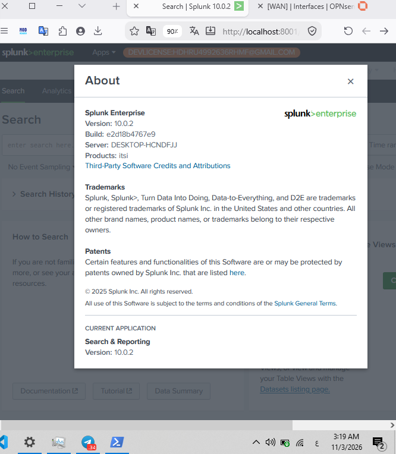
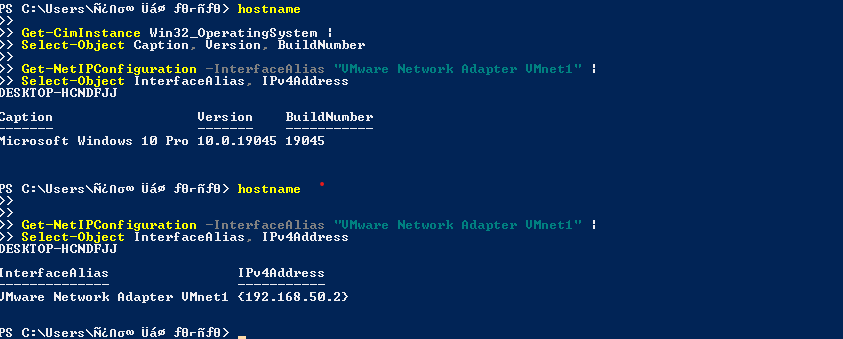
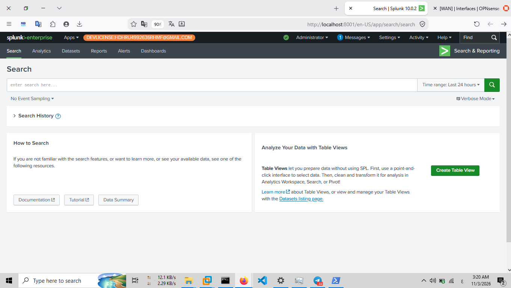

# Splunk Enterprise Installation & Deployment

## 1. Overview

This document describes the Splunk Enterprise deployment used as the central SIEM platform in the SOC Home Lab.

Splunk Enterprise is installed directly on the Windows host machine rather than inside a dedicated virtual machine. It provides the central platform for searching, analyzing, and investigating security events collected from the lab environment.

The deployment is used for security monitoring, log analysis, threat hunting, and incident investigation.

## 2. Deployment Environment

| Component | Configuration |
|---|---|
| SIEM Platform | Splunk Enterprise |
| Installation Host | Windows Host Machine |
| Deployment Type | Host-based installation |
| Splunk Version | 10.0.2 |
| Build | e2d18b4767e9 |
| Installation Directory | `C:\Program Files\Splunk` |
| Host IP Address | `192.168.50.2` |
| Splunk Web Interface | `http://127.0.0.1:8001` |
| Windows Service | `Splunkd` |
| Service Status | Running |

### Installation Architecture

Splunk Enterprise runs directly on the Windows host, which is connected to the lab's internal network.

The host provides the central SIEM platform for receiving and analyzing security telemetry from the lab environment.

**Deployment characteristics:**

- Splunk Enterprise runs on the Windows host.
- The internal lab network uses the `192.168.50.0/24` subnet.
- The Splunk host uses the internal network address `192.168.50.2`.
- Splunk Web is accessed locally through port `8001`.

## 3. Splunk Enterprise Version

The installed Splunk Enterprise version was verified using the Splunk command-line interface.

**Verification command:**

```powershell
& "C:\Program Files\Splunk\bin\splunk.exe" version
```

**Verified output:**

```text
Splunk 10.0.2 (build e2d18b4767e9)
```

### Evidence



*Figure 1: Installed Splunk Enterprise version and build information.*

## 4. Installation Directory

Splunk Enterprise is installed in the following directory:

```text
C:\Program Files\Splunk
```

The installation directory contains the Splunk executable files, configuration directories, applications, and other components required to operate the platform.

The main command-line executable is located at:

```text
C:\Program Files\Splunk\bin\splunk.exe
```


## 5. Splunk Service Verification

The Windows service responsible for running the Splunk Enterprise instance was identified as `Splunkd`.

The service configuration was inspected using PowerShell:

```powershell
Get-CimInstance Win32_Service -Filter "Name='Splunkd'" |
Format-List Name, State, StartMode, PathName
```


**Verified service information:**

| Property | Value |
|---|---|
| Service Name | `Splunkd` |
| State | Running |
| Startup Type | Manual |
| Executable | `C:\Program Files\Splunk\bin\splunkd.exe` |

The `Splunkd` service provides the core Splunk Enterprise processing functionality.

### Evidence



*Figure 2: Windows host system used to run the Splunk Enterprise platform.*

## 6. Splunk Web Interface

Splunk Web provides the browser-based interface used to interact with the SIEM platform.

The local interface is accessible at:

```text
http://127.0.0.1:8001
```

The interface is used for:

- Searching and analyzing indexed events.
- Investigating security alerts and suspicious activity.
- Creating searches and reports.
- Developing dashboards.
- Monitoring ingested security telemetry.

The interface was verified by successfully accessing Splunk Web and logging into the platform.

### Evidence



*Figure 3: Splunk Web interface running on the Windows host.*

## 7. Deployment Verification

The deployment was verified through the following checks:

| Verification | Result |
|---|---|
| Splunk Enterprise executable | Available |
| Installed version | Verified: 10.0.2 |
| Installation directory | Identified |
| Windows service | `Splunkd` |
| Service state | Running |
| Splunk Web access | Verified |
| Web interface login | Successful |

These checks confirm that the Splunk Enterprise instance is installed and operational on the Windows host.

## 8. Role in the SOC Home Lab

Splunk Enterprise serves as the central SIEM platform within the lab architecture.

It supports the following security operations:

1. Centralized security event analysis.
2. Windows and Sysmon telemetry investigation.
3. Network security log analysis.
4. Threat hunting using SPL.
5. Detection development and alert investigation.
6. Incident analysis and evidence documentation.

Additional documentation covers Universal Forwarder configuration and data ingestion.

## 9. Related Documentation

- [Universal Forwarder Configuration](universal-forwarder.md)
- [Data Ingestion and Event Analysis](data-ingestion.md)

## 10. References

- [Splunk Enterprise Documentation – Install on Windows](https://help.splunk.com/en/splunk-enterprise/get-started/install-and-upgrade/9.0/install-splunk-enterprise-on-windows/install-on-windows)

---

**Project:** SOC Home Lab – Splunk Detection Engineering & Incident Response

**Component:** Splunk Enterprise SIEM Deployment