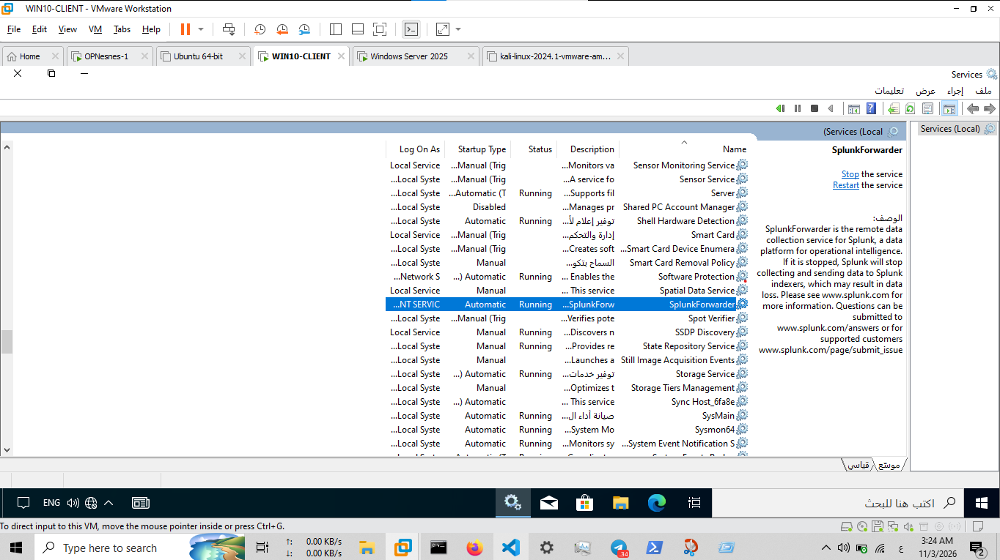

# Splunk Universal Forwarder Configuration

## 1. Overview

This document describes the Splunk Universal Forwarder deployment used to collect and forward endpoint telemetry to the central Splunk Enterprise SIEM platform.

The Universal Forwarder is a lightweight Splunk component designed to collect machine-generated data from endpoint systems and forward it to a configured Splunk receiving instance.

In this SOC Home Lab, the Universal Forwarder is used on the Windows domain endpoint to support centralized security monitoring and investigation.

## 2. Deployment Architecture

The lab uses two separate Windows systems for log collection and analysis:

| Component | Role |
|---|---|
| Windows Domain Endpoint | Source of endpoint telemetry |
| Splunk Universal Forwarder | Collects and forwards endpoint data |
| Windows Host | Runs Splunk Enterprise |
| Splunk Enterprise | Receives, indexes, and analyzes events |

### Network Configuration

| Component | Address |
|---|---|
| Windows Domain Endpoint | `192.168.50.126` |
| Splunk Enterprise Host | `192.168.50.2` |
| Splunk Receiving Port | `9997` |

The configured forwarding destination is the Splunk Enterprise host on TCP port `9997`.

The current active forwarding status has not yet been re-verified in this documentation session.

## 3. Universal Forwarder Service

The Universal Forwarder runs as a Windows service named:

```text
SplunkForwarder
```

This service is responsible for running the forwarder's background processes and supporting data collection and forwarding.

The service can be inspected using PowerShell:

```powershell
Get-Service SplunkForwarder
```

To retrieve additional service information:

```powershell
Get-CimInstance Win32_Service -Filter "Name='SplunkForwarder'" |
Format-List Name, State, StartMode, PathName
```

### Evidence



*Figure 1: Windows Services evidence associated with the Splunk Universal Forwarder deployment.*

## 4. Forwarding Destination

The Universal Forwarder is intended to send collected telemetry to the central Splunk Enterprise receiving endpoint.

**Configured destination:**

```text
192.168.50.2:9997
```

The receiving port is used for Splunk-to-Splunk data forwarding.

The forwarding configuration is associated with the Universal Forwarder's output settings, commonly managed through the `outputs.conf` configuration file.

The actual configuration should be verified on the endpoint before making claims about the current connection state.

## 5. Forwarding Verification

The following command can be executed from the Universal Forwarder's installation directory to inspect configured forwarding destinations:

```powershell
.\splunk.exe list forward-server
```

The command reports forwarding destinations under two categories:

- **Active forwards:** Destinations with an active forwarding connection.
- **Configured but inactive forwards:** Destinations configured in the forwarder but not currently active.

An active forwarding connection alone does not prove that all expected event data is being collected and indexed. Event searches on the receiving Splunk Enterprise instance are also required.

## 6. Role in the SOC Home Lab

The Universal Forwarder supports endpoint telemetry collection and centralized security monitoring.

Its role in the lab includes:

1. Collecting endpoint-generated event data.
2. Forwarding telemetry to the central Splunk Enterprise instance.
3. Supporting Windows security event investigations.
4. Supporting Sysmon-based detection and threat hunting.
5. Providing endpoint visibility for incident response activities.

## 7. Verification Scope and Limitations

The service evidence documents the Universal Forwarder service deployment.

The forwarding destination and connection status must be verified directly on the Windows domain endpoint. A forwarding status check performed on the Splunk Enterprise host does not establish the Universal Forwarder's connection state.

No active forwarding status is claimed in this document until endpoint-side verification is completed.

## 8. Related Documentation

- [Splunk Enterprise Installation](installation.md)
- [Data Ingestion and Event Analysis](data-ingestion.md)

---

**Project:** SOC Home Lab – Splunk Detection Engineering & Incident Response

**Component:** Splunk Universal Forwarder