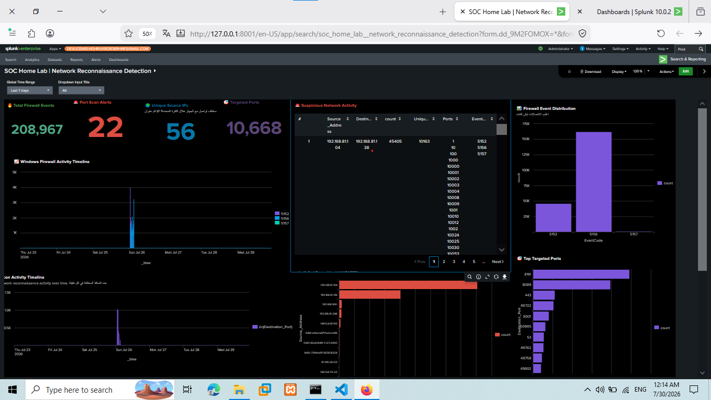
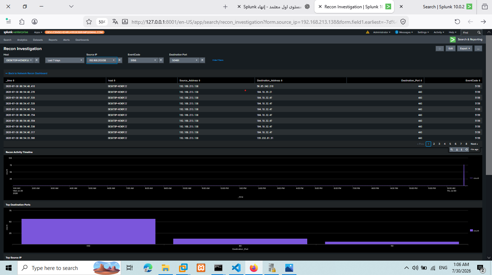

# 🛡️ SOC Home Lab | Detection Engineering & Threat Hunting using Splunk


---

## 📌 Overview

A practical **Security Operations Center (SOC) home lab** designed to simulate attack activity, collect security telemetry, develop detection logic, perform threat hunting, and investigate security events using **Splunk Enterprise**.

The lab combines virtual machines running in VMware Workstation with a Splunk SIEM instance installed directly on the **physical Windows host**. Splunk Enterprise is not running inside a VMware virtual machine; the Windows host provides the central SIEM platform and receives forwarded security data from the lab network.

The environment includes:

- **Windows Server / Active Directory** for domain services, identity management, and authentication telemetry.
- **Windows 10 domain endpoint** for endpoint activity, Windows Event Logs, and Sysmon telemetry.
- **Ubuntu Linux endpoint** for Linux system activity and log collection.
- **Kali Linux** for authorized adversary emulation and attack simulation.
- **OPNsense Firewall** for routing, network segmentation, traffic filtering, and firewall logging.
- **Suricata IDS/IPS** for network intrusion detection and security monitoring.
- **Splunk Enterprise** for centralized log ingestion, searching, detection engineering, threat hunting, and dashboards.

The project follows a SOC-oriented workflow:

> **Attack Simulation → Telemetry Collection → Log Ingestion → Detection Engineering → Alert Analysis → Threat Hunting → Incident Investigation → Documentation**

The objective is not simply to execute attack tools. It is to understand how an analyst identifies suspicious behavior, validates alerts, correlates endpoint, identity, and network evidence, builds an event timeline, documents findings, and recommends appropriate response actions.

---

## 🎯 Key Objectives

- 🎯 **Attack Simulation:** Emulate selected adversary techniques in a controlled lab and map observed behavior to MITRE ATT&CK.
- 🏢 **Identity Monitoring:** Monitor Active Directory authentication, Kerberos, NTLM, and account activity.
- 🖥️ **Endpoint Monitoring:** Collect Windows Security Logs, Sysmon events, and endpoint process activity.
- 🐧 **Linux Monitoring:** Collect and investigate relevant Linux endpoint activity from Ubuntu.
- 🌐 **Network Security Monitoring:** Observe network activity through OPNsense and Suricata.
- 🔥 **Firewall Monitoring:** Analyze firewall allow/block events and suspicious connections.
- 🚨 **IDS/IPS Monitoring:** Review Suricata alerts and investigate network-based indicators.
- 🔍 **Detection Engineering:** Develop, test, and refine SPL-based detection searches.
- 🕵️ **Threat Hunting:** Form hypotheses and validate them against available telemetry.
- 📊 **Security Dashboards:** Build SOC-oriented dashboards in Splunk.
- 📝 **Incident Documentation:** Produce structured incident reports with evidence, timelines, findings, and recommendations.
- 🧩 **MITRE ATT&CK Mapping:** Classify observed adversary behavior using relevant tactics and techniques.

---

# 🏗️ Architecture & Lab Environment

The lab uses a segmented virtual network for the attack simulation and monitored endpoints. VMware Workstation hosts the lab virtual machines, while Splunk Enterprise runs directly on the physical Windows host.

### Core Architecture

```text
                    PHYSICAL WINDOWS HOST
              ┌────────────────────────────────┐
              │       Splunk Enterprise        │
              │          SIEM Platform         │
              │                                │
              │  - Log Ingestion               │
              │  - SPL Search & Detection      │
              │  - Threat Hunting              │
              │  - Dashboards & Investigation  │
              └───────────────▲────────────────┘
                              │
                   Forwarded Logs / Syslog
                              │
                    VMware Lab Network
                              │
                 ┌────────────┴────────────┐
                 │                         │
                 ▼                         ▼
        ┌──────────────────┐      ┌──────────────────┐
        │   Kali Linux     │      │    OPNsense      │
        │ Adversary / Test │─────▶│ Firewall Gateway │
        │    Machine       │      │   + Suricata     │
        └──────────────────┘      └────────┬─────────┘
                                           │
                                      Internal LAN
                                           │
                  ┌────────────────────────┼──────────────────────┐
                  │                        │                      │
                  ▼                        ▼                      ▼
        ┌──────────────────┐    ┌──────────────────┐    ┌──────────────────┐
        │ Windows Server   │    │ Windows 10       │    │ Ubuntu Linux     │
        │ Active Directory │    │ Domain Endpoint  │    │ Endpoint         │
        │ Identity Layer   │    │ Endpoint Layer   │    │ Linux Telemetry  │
        └──────────────────┘    └──────────────────┘    └──────────────────┘
                  │                        │                      │
                  └────────────────────────┴──────────────────────┘
                                           │
                               Security Logs / Telemetry
                                           │
                                           ▼
                                Splunk Enterprise
                              (Physical Windows Host)
```

### Network Overview

The internal lab network uses the `192.168.50.0/24` subnet.

| System | Role | Lab IP |
| :--- | :--- | :--- |
| OPNsense | LAN gateway / firewall | `192.168.50.1` |
| Splunk physical host | Central SIEM (outside the VMs) | `192.168.50.2` |
| Active Directory server | Domain controller / DNS | `192.168.50.10` |
| Ubuntu Linux | Linux endpoint | `192.168.50.111` |
| Windows 10 | Domain endpoint | `192.168.50.126` |
| Kali Linux | Adversary emulation | `192.168.50.137` |

> **Deployment note:** The IP addresses above describe the lab configuration documented for this project. They may change if the virtual network or DHCP configuration is modified.

---

## 🧱 Lab Components

| Component | Technology | Role |
| :--- | :--- | :--- |
| **SIEM** | Splunk Enterprise 10.0.2 | Centralized log ingestion, searching, detection, investigation, and visualization |
| **SIEM Host** | Physical Windows host | Runs Splunk Enterprise directly, outside VMware virtual machines |
| **Virtualization** | VMware Workstation | Hosts the isolated lab virtual machines and virtual networks |
| **Identity Infrastructure** | Windows Server + Active Directory | Domain services, authentication, DNS, and identity management |
| **Windows Endpoint** | Windows 10 | Endpoint activity, Windows Security Logs, and Sysmon telemetry |
| **Linux Endpoint** | Ubuntu Linux | Linux system activity and endpoint log collection |
| **Endpoint Telemetry** | Sysmon | Process, network, file, registry, and system monitoring on Windows |
| **Attacker / Test Machine** | Kali Linux | Authorized adversary emulation and attack simulation |
| **Firewall / Gateway** | OPNsense | Network routing, filtering, segmentation, and firewall logging |
| **Network IDS/IPS** | Suricata | Network intrusion detection and prevention telemetry |
| **Log Collection** | Windows Event Logs / Sysmon / Syslog / Forwarded Logs | Security event collection and central analysis |
| **Threat Framework** | MITRE ATT&CK | Adversary behavior classification and technique mapping |

---

# 🔐 Security Monitoring Layers

The environment is divided into identity, endpoint, network, and SIEM layers. Each layer provides a different view of activity and can contribute evidence during an investigation.

### 1. Identity Layer

**Windows Server / Active Directory**

This layer provides visibility into domain authentication and identity-related activity.

Monitored activity includes:

- Successful and failed authentication.
- Logon type analysis.
- Kerberos authentication.
- NTLM authentication.
- Account and group activity.
- Domain authentication.
- Privileged account activity.
- Unusual authentication patterns.

Relevant Windows Security Event IDs include:

```text
4624  Successful Logon
4625  Failed Logon
4648  Explicit Credential Logon
4672  Special Privileges Assigned
4688  Process Creation (when process auditing is configured)
4768  Kerberos Authentication Ticket Requested
4769  Kerberos Service Ticket Requested
4771  Kerberos Pre-Authentication Failed
4776  NTLM Authentication
```

### 2. Endpoint Layer

**Windows 10 + Sysmon**

Windows endpoint telemetry is used to investigate process execution, PowerShell activity, file and registry changes, network connections, and suspicious parent-child process relationships.

Examples of monitored activity include:

```text
Process Creation
Network Connections
DNS Queries
File Creation
Registry Activity
PowerShell Activity
Process Relationships
```

Sysmon events are correlated with Windows Security and PowerShell logs where the relevant audit and logging configurations are enabled.

**Ubuntu Linux Endpoint**

The Ubuntu endpoint extends monitoring beyond Windows and provides a Linux system from which relevant host and service logs can be collected and investigated. Linux telemetry is useful for examining authentication, service activity, process execution, and other host-level events, depending on the configured log sources and collection settings.

### 3. Network Security Layer

**OPNsense Firewall + Suricata**

OPNsense provides network visibility and enforcement through:

- Firewall allow/deny events.
- Network connection logging.
- Interface-level visibility.
- Traffic filtering.
- Network segmentation.
- Syslog forwarding.

Suricata provides:

- Network intrusion detection.
- Signature-based detection.
- Suspicious traffic analysis.
- IDS/IPS alerts.
- Network security telemetry.
- EVE JSON / syslog-based event data, where configured.

### 4. SIEM Layer

**Splunk Enterprise on the Physical Windows Host**

Splunk Enterprise is installed directly on the physical Windows host, not in a VMware virtual machine. It acts as the central SIEM and analysis platform for the lab.

Its responsibilities include:

```text
Log Ingestion
     ↓
Search & Data Analysis
     ↓
SPL Detection
     ↓
Alert Validation
     ↓
Event Correlation
     ↓
Threat Hunting
     ↓
Dashboard Visualization
     ↓
Incident Documentation
```

The lab uses Splunk to search and correlate collected telemetry. The presence of a configured data source or forwarding destination does not, by itself, prove that a forwarder is currently connected or that every expected event is being ingested; operational status is validated separately.

---

# 📡 Telemetry Sources

The lab uses multiple telemetry sources to support investigations across different layers.

| Source | Telemetry | Security Value |
| :--- | :--- | :--- |
| **Windows Security Logs** | Authentication, account, privilege, and process-related events | Identity and endpoint detection |
| **Sysmon** | Process, network, file, registry, and DNS telemetry | Detailed Windows endpoint visibility |
| **PowerShell Logs** | PowerShell engine and script-block activity, when enabled | Script execution investigation |
| **Active Directory** | Domain authentication and identity activity | Identity monitoring |
| **Ubuntu Linux** | Linux host and service logs, according to configured sources | Linux endpoint monitoring |
| **OPNsense** | Firewall and network events | Network visibility and enforcement |
| **Suricata** | IDS/IPS alerts and network event data | Network threat detection |
| **Kali Linux** | Authorized attack and test activity | Adversary simulation context |
| **Splunk Enterprise** | Indexed and searchable security data | Centralized detection and investigation |

---

# ⚔️ Attack Scenarios & Detection Coverage

The scenarios below represent the attack simulation and detection work documented or under development in this repository. Status labels distinguish completed work from scenarios that are still being developed or validated.

| ID | Attack Scenario | MITRE ATT&CK | Status | Documentation |
| :---: | :--- | :---: | :---: | :--- |
| 01 | Network Reconnaissance (Nmap) | [T1046](https://attack.mitre.org/techniques/T1046/) | 🟢 Completed | [Network Reconnaissance](./01-Network-Reconnaissance-Nmap/) |
| 02 | SSH/RDP Brute Force (Hydra) | [T1110](https://attack.mitre.org/techniques/T1110/) | 🟢 Completed | [Brute Force - Hydra](./02-Brute-Force-Hydra/) |
| 03 | Malicious PowerShell Execution | [T1059.001](https://attack.mitre.org/techniques/T1059/001/) | 🟢 Documented | [PowerShell Attack](./1-Threat-Hunting-Scenarios/03-PowerShell-Attack/) |
| 04 | Ingress Tool Transfer | [T1105](https://attack.mitre.org/techniques/T1105/) | 🟢 Completed | [Ingress Tool Transfer](./1-Threat-Hunting-Scenarios/04-Ingress-Tool-Transfer-T1105/) |
| 05 | Kerberoasting Detection | [T1558.003](https://attack.mitre.org/techniques/T1558/003/) | 🟢 Completed | [Kerberoasting Detection](./1-Threat-Hunting-Scenarios/05-Kerberoasting-Detection/) |
| 06 | OS Credential Dumping - Dataset Analysis | [T1003.001](https://attack.mitre.org/techniques/T1003/001/) | 🟡 Analysis in Progress | [Threat Hunting Scenarios](./1-Threat-Hunting-Scenarios/) |

> **Status note:** “Documented” means the scenario has supporting documentation in the project. “In Progress” means detection validation, evidence collection, or investigation work is not yet complete. A saved search or an observed event should not be described as a fully validated alert unless its triggering behavior has been tested.

Additional monitoring work includes Active Directory authentication, firewall events, Suricata alerts, and cross-source correlation. These are monitoring and detection areas and are not represented as completed attack simulations unless a dedicated scenario and evidence are available.

---

# 🔎 Detection Engineering Workflow

The project follows a repeatable workflow for developing and validating detections:

```text
             Attack Simulation
                    │
                    ▼
       Endpoint / Identity / Network
                Telemetry
                    │
                    ▼
             Splunk Ingestion
                    │
                    ▼
            Data Normalization
                    │
                    ▼
              SPL Detection
                    │
                    ▼
             Alert / Finding
                    │
                    ▼
             Alert Validation
                    │
                    ▼
             SOC Investigation
                    │
                    ▼
               Threat Hunting
                    │
                    ▼
            MITRE ATT&CK Mapping
                    │
                    ▼
              Incident Report
                    │
                    ▼
            Detection Improvement
```

Detection development is not considered complete merely because a search returns events. The query must be reviewed against the available data, expected behavior, false positives, and the intended detection objective.

---

# 📊 Dashboard & Investigation

Splunk dashboards are used to summarize relevant activity and support investigation.

### Network Reconnaissance Detection Dashboard



### Reconnaissance Investigation Dashboard



Future dashboard coverage may include:

- Active Directory authentication.
- Windows Security Events.
- PowerShell activity.
- Linux endpoint activity.
- Firewall activity.
- Suricata IDS alerts.
- Network reconnaissance.
- Brute-force activity.
- Endpoint process execution.
- Cross-source correlation.

---

# 📝 Incident Investigation Methodology

Each documented investigation follows a consistent SOC workflow:

```text
1. Detection
      ↓
2. Alert Validation
      ↓
3. Event Collection
      ↓
4. Timeline Construction
      ↓
5. Source / Destination Analysis
      ↓
6. User / Host Analysis
      ↓
7. MITRE ATT&CK Mapping
      ↓
8. Evidence Collection
      ↓
9. Impact Assessment
      ↓
10. Recommended Response
      ↓
11. Incident Documentation
```

Each incident is documented using a structured `incident_report.md` format. Depending on the scenario, supporting evidence may include SPL searches, alert configuration, event records, screenshots, process relationships, network indicators, and a chronological timeline.

The repository's scenario documentation is organized around the workflow:

**Attack → Telemetry → SPL → Alert → Dashboard → Incident Report**

---

# 🧠 Skills Demonstrated

### Splunk / SIEM

- Splunk Enterprise Administration.
- SPL Query Development.
- Detection Engineering.
- Log Analysis.
- Data Correlation.
- Dashboard Development.
- Security Monitoring.
- Search Validation.

### Windows / Active Directory

- Windows Security Event Analysis.
- Active Directory Monitoring.
- Authentication Analysis.
- Kerberos / NTLM Event Analysis.
- Process Creation Analysis.
- PowerShell Logging and Investigation.
- Windows Endpoint Telemetry.

### Linux

- Ubuntu Linux Endpoint Monitoring.
- Linux Log Collection and Analysis.
- Host and Service Activity Investigation.

### Network Security

- OPNsense Firewall Administration.
- Firewall Rule Analysis.
- Network Traffic Monitoring.
- Syslog Collection.
- Suricata IDS/IPS.
- Network Intrusion Detection.
- Network Segmentation.

### SOC Operations

- Alert Triage.
- Threat Hunting.
- Incident Investigation.
- Evidence Analysis.
- Timeline Construction.
- MITRE ATT&CK Mapping.
- Incident Documentation.
- Detection Improvement.

---

# 🚀 Current Lab Status

| Area | Status |
| :--- | :---: |
| Splunk Enterprise on Physical Windows Host | 🟢 Operational |
| VMware Lab Network | 🟢 Configured |
| Windows Domain Endpoint | 🟢 Operational |
| Windows Server / Active Directory | 🟢 Configured |
| Sysmon Telemetry | 🟢 Configured |
| Kali Linux Attack Simulation | 🟢 Available |
| Ubuntu Linux Endpoint | 🟢 Added |
| OPNsense Firewall | 🟢 Configured |
| Suricata IDS/IPS | 🟡 Configuration / Detection Development |
| Network Reconnaissance Scenario | 🟢 Completed |
| Hydra Brute Force Scenario | 🟢 Completed |
| PowerShell Attack Documentation | 🟢 Documented |
| Ingress Tool Transfer Detection | 🟡 In Progress |
| Kerberoasting Detection | 🟢 Completed |
| OS Credential Dumping Dataset Analysis | 🟡 In Progress |
| Active Directory Detection | 🟡 In Progress |
| Network Security Detection | 🟡 In Progress |
| Cross-Source Correlation | 🟡 In Progress |

> Operational status refers to the documented lab setup. Individual data sources, forwarder connections, detections, and alerts should be validated independently before being reported as fully operational.

---

# 🎯 Future Development

The lab will continue evolving toward a more realistic SOC environment.

Planned improvements include:

- Complete validation of Kerberoasting detection.
- Expand Active Directory attack simulations.
- Develop password spraying detection.
- Improve privileged account monitoring.
- Expand PowerShell threat hunting.
- Investigate Windows lateral movement.
- Continue OS credential dumping detection research.
- Tune Suricata rules and review alert quality.
- Correlate firewall events with endpoint telemetry.
- Develop cross-source detection logic.
- Validate alert triggering and suppression behavior.
- Improve risk-based alert prioritization.
- Add SOC dashboards for Windows and Linux telemetry.
- Expand MITRE ATT&CK coverage.
- Apply Detection-as-Code practices.
- Improve incident timelines and evidence documentation.

---

# 🏆 Project Goal

The ultimate goal is to build a realistic, documented, and continuously improving **SOC detection engineering laboratory** that demonstrates practical skills in security monitoring, detection development, threat hunting, and incident investigation.

> **Simulate → Collect → Detect → Correlate → Hunt → Investigate → Document → Improve**

The lab combines multiple telemetry perspectives:

```text
Identity
   +
Windows Endpoint
   +
Linux Endpoint
   +
Network
   +
Firewall
   +
IDS/IPS
   ↓
Splunk Enterprise SIEM
(Installed on the Physical Windows Host)
   ↓
SOC Detection & Investigation
```

This project serves as a practical demonstration of SOC Level 1 / Level 2 analysis, Splunk detection engineering, Windows security monitoring, Active Directory monitoring, Linux endpoint visibility, network security monitoring, and MITRE ATT&CK-based investigation.
